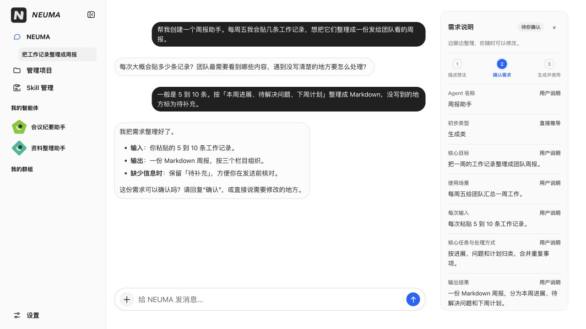
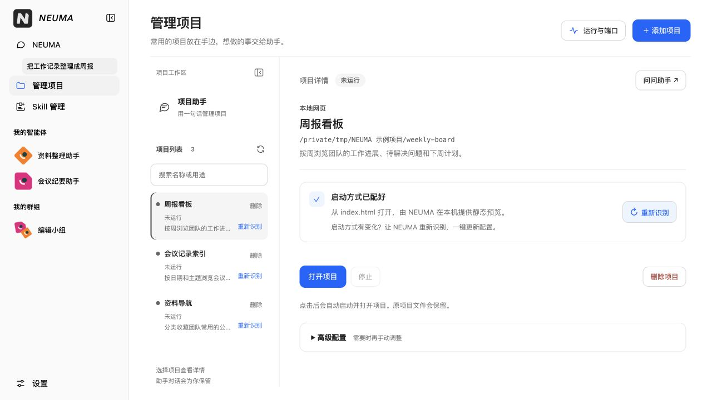

# NEUMA

NEUMA（纽玛）是一个本机智能体工作台。你可以在主对话里描述一项反复要做的工作，例如把每周的零散记录整理成周报。NEUMA 会和你一起确定输入和交付格式，再制作一个可以反复使用的助手。已有的助手可以组成群组，共享材料、分工并汇总结果。

[快速开始](#快速开始) · [工作台入口](#工作台入口) · [源码开发](#源码开发) · [详细使用指南](docs/user-guide.md)



*周报助手的需求进入「待你确认」时，可以对照右侧草稿，在原对话里直接修改。本文两张截图均取自 `main` 分支运行的桌面界面，使用演示数据。*

## 快速开始

试用版支持 **Apple 芯片 Mac（M 系列）、macOS 14 或更新版本**。请使用 ARM64 版 Node.js，推荐 26+，也支持 22.x 的 22.22.2+ 和 24.x 的 24.15.0+。

### 1. 启动工作台

**从源码运行**可以使用截图里的界面。在终端执行以下命令，然后打开终端显示的本机地址，默认是 `http://127.0.0.1:3000`。

```sh
git clone https://github.com/Chriss09-ui/NEUMA.git neuma
cd neuma
npm ci --ignore-scripts
cp .env.example .env
npm start
```

**使用 npm 试用包**时，先安装，再运行 `neuma` 启动服务并打开浏览器。npm 的 `preview` 标签单独发布，例如 `0.1.0-preview.2` 的「新对话」按钮位于主聊天区顶部。更新时先按 Ctrl+C 关闭服务，再执行同一组命令。[npm 试用包](https://www.npmjs.com/package/@chrissliu/neuma)

```sh
npm install -g @chrissliu/neuma@preview
neuma
```

### 2. 连接模型

打开左下角「设置」，在「模型服务」中填写**接口地址、模型名和 API Key**。使用兼容 OpenAI Chat Completions 的接口，地址以 `/chat/completions` 结尾，模型需要支持流式回复和工具调用。可以先点「测试连接」，再点「保存设置」。需要模型处理的内容会发给所选服务商，费用按其规则计算。

同页的「Jev 判断」可选。配置后，Jev辅助需求判断，也分别复核架构和研发各评审小组的打回意见。未配置时使用普通评审；已开始的Jev任务保留原报告、绑定和进度。

### 3. 创建第一个智能体

在左侧打开「NEUMA」，试着发一条消息。

> 帮我创建一个周报助手。每周五我会贴 5 到 10 条工作记录，请按本周进展、待解决问题和下周计划整理成 Markdown。记录里没提到的信息标为「待补充」。

1. 回答会影响结果的追问，查看右侧「需求说明」里的输入、输出和完成标准。想换格式或补一条规则，直接在同一个输入框说明。
2. 草稿显示「待你确认」后，回复「确认」或点「确认需求并开始制作」。需求保存成功后，工作台会自动打开这个智能体，开始方案设计和独立评估。轻量助手通过检查后即可使用，需要代码的方案会继续研发和验收。
3. 等智能体就绪，从「我的智能体」打开它，贴入这周的记录。也可以点输入框旁的「＋」上传或选用已有材料。想留下文件时，请它把周报保存为 `周报.md`，再点对话顶部的智能体名称，打开「产物」预览或下载。

架构只说明总体做法、关键职责、业务输入输出和主要失败响应；具体研发任务、内部实现和可执行测试材料在研发阶段准备，不作为架构打回条件。

如果方案需要编写代码，制作页会显示任务拆分、开发、验收和交付进度。较大的任务可按模块分工。每个模块交回一段设计说明，系统依照组件标记检查每条需求是否有对应业务验收场景。架构评审交接检查结果和资料文件位置，需要的原文由下一个节点读取。若额外附带原文，程序核对一致后仍只交接位置，冲突则指出具体字段。配置 Jev 后，每组评审 AI 可通过本组；打回意见由本组 Jev 逐条判断，必要分达到 75 且过严分低于 50 时交回设计修改，其余通过并可保留建议；分歧和置信信息不再触发额外补查或暂停。程序汇总各组结果，接口组负责跨组一致性，独立范围复核继续执行。未配置时沿用普通评审。汇总仍要求修改时，制作流程自动使用已有的一次局部修订机会，改稿后重新检查、独立评审和范围复核，通过后才进入研发或交付。修订后仍有阻断则停止并保存意见。阶段化设计中的模型请求和正常读取只记录用量；格式错误连续三次停止，方案内容退回累计五次停止，两者分别计数。中途停止可从已保存的检查点继续，原计数保留。整合时可按明确的字段类型还原合法的对象或列表文字；旧格式停点可复核原会话最后一稿，通过完整检查后继续，不必让模型重复生成。

研发计划、单任务及集成修复按责任任务累计5次内容退回，格式问题先明确反馈，再给3次实际纠正机会；首次错误、正常读取和连接重试不扣纠正机会，模型请求只记用量。每轮只带最新稿、上轮反馈和未解决问题，旧记录按需读取。各组Jev可撤销过严意见，实际测试失败仍须修复。新旧架构报告均可接收，恢复保留原会话、结果和计数。

明确的多余闭合符或字段套层错误可由程序还原，再照常完整校验；无法确定的错误反馈具体位置。研发分组的旧格式停点可复核原会话最后一稿，通过后接着做，原失败记录和已用次数保留。

用例断言中的 `/error` 等无歧义路径可自动规范化，再完整校验；不能确定的写法反馈具体位置，使用独立格式纠正机会，不计入内容退回。原输入、预期和历史记录保留。

规划 AI 同轮交修订稿并报告问题时，修改稿保留为草稿，核验有效的问题报告决定停点；正常交接结束后不额外请求模型。

研发规划和用例节点共享平台真实支持的测试手段，程序提前指出不存在的模拟工具及具体位置；待开发代码名称不能充当平台工具，也不为测试增加业务连接。研发规划会检查可明确对照的测试输入是否能到达约定的检查环节。接口与验收冲突时交回规划修正，用例小组收到当前接口及本组必要材料；旧结果、会话和计数保留，受影响用例重新检查。

## 工作台入口

架构修改和评审每轮只携带最新稿、上一轮反馈及未解决问题；旧稿和旧交互保留，需要时再读取。恢复时按方案版本核对评审归属，原会话和退回计数继续保留。

| 入口 | 可以做什么 |
| --- | --- |
| **NEUMA** | 创建或迭代助手，给群组派发任务，或问「编辑小组的周报做到哪一步了」。右侧按当前对话展示需求或群任务详情。 |
| **我的智能体** | 打开专属对话，继续历史记录，编辑这个助手的记忆或查看产物。已就绪的助手可以复用自己的上传材料，回复支持列表、代码和数学公式。 |
| **我的群组** | 点击分区标题，再点「创建群组」选择成员。群里可以上传共享材料，也可以用 `@` 点名成员。就绪成员可认领任务、互相求助，由本轮的整合者汇总成果。 |
| **Skill 管理** | 搜索本机技能，查看来源与配套文件，编辑可写的 `SKILL.md`。从文件夹导入时，可以选择通用、Codex、Claude、Pi 或项目目录。 |

侧栏里的「我的智能体」和「我的群组」标题分别打开管理页。点具体条目可展开或收起它的历史。鼠标悬停或用键盘聚焦条目时，右侧会出现方框加笔图标，可以为该助手开启新对话，或在群里开启新话题。

### 管理已有本机项目

打开「管理项目」，点「＋ 添加项目」，选中项目文件夹或粘贴路径，再点「添加并自动配置」。模型识别启动方式后，项目就会出现在列表里。选择项目后点「打开项目」即可使用。要查正在运行的项目或端口占用，点右上角「运行与端口」。



*示例中的「周报看板」是一个已配置、尚未启动的本地网页。项目文件留在原文件夹，启动时使用当前账户的权限和项目自身的运行环境。*

### 使用应用与外部连接

如果任务需要表单、筛选或导出，在创建时说明希望怎样操作。例如，把周报需求改为「在工作台里按周查看记录，勾选本次要导出的条目」。交付了页面的智能体可以切换「应用」和「对话」，也可以在应用里展开「助手」。页面和对话共用已验收的操作。

正式智能体默认可以搜索和读取公开网页，也可以在任务中明确要求不联网。专属搜索、模型、HTTP 或 MCP 业务连接在该智能体的「连接与模型」中按需配置。需要连接的操作会提示缺少的配置。要供其他本机工具调用，可在「运行与接口」中选择允许使用的操作并启用 API/MCP 接口。[连接指南](docs/connections-guide.md) · [智能体能力与服务](docs/agent-capabilities-and-services.md)

## 数据与运行范围

- **材料和产物。** 支持常见文档、表格、演示文稿、PDF、图片和文本代码文件。单个材料最多 20 MiB，每条消息最多关联 10 个。读取图片和扫描件需要支持图片输入的模型。同一智能体的不同对话可复用材料，分享给群组时由你选择具体文件。
- **本机数据。** npm 安装版默认把设置、对话和智能体工作目录保存在 `~/.neuma/`。源码版使用仓库内的 `.neuma/` 存储工作数据，使用仓库根目录的 `.env` 保存模型设置。
- **任务进度。** 本机服务运行时，主对话、智能体制作、群任务和应用操作可以在切页或关闭浏览器后继续。重新打开原对话或智能体即可查看进度。服务重启后可根据记录和检查点处理未完成的工作，外部操作不会自动重放。
- **执行环境。** 生成的程序在隔离环境中运行。根据已评审的方案，工作台可以执行内置 Node 操作或启动受管 JavaScript/Python 服务。选择容器时还需要可用的本机 Docker 引擎。当前支持用户主动发起的工作，暂不支持后台定时、外部事件触发或公有云部署。

## 源码开发

`npm start` 先严格编译 TypeScript，再从 `dist/ts-build/package/` 启动。服务端在 `src/`，桌面网页在 `public/`，测试按领域放在 `test/`。

```sh
npm run check:hygiene        # 检查模块边界、测试登记和文档引用
npm run typecheck            # 严格类型检查
npm run test:unit            # 模块、界面和 API 单元测试
npm run test:integration     # 本机模拟模型、进程和隔离执行测试
npm test                     # 全量回归，外部浏览器测试需显式启用
npm run release:preview:check
npm run package:pack         # 编译并生成试用安装包到 dist/npm/
```

安装版可用 `neuma --no-open` 手动打开网页、`neuma --port 3010` 指定端口、`neuma doctor` 检查运行和隔离能力。其他启动参数见 `neuma --help`。独立安装、数据迁移和打包验证见 [安装指南](docs/npm-installation.md)。

## 文档

| 想了解的内容 | 文档 |
| --- | --- |
| 创建助手、共享材料、管理项目和本机技能 | [使用指南](docs/user-guide.md) |
| 各层的职责、状态、数据流与中断恢复 | [架构基线](ARCHITECTURE.md) · [节点与字段](docs/node-flow-and-fields.md) · [运行可靠性实施记录](docs/runtime-reliability-implementation-2026-10-26.md) |
| 代码型智能体怎样从任务拆分走到验收与交付 | [研发层设计](docs/development-layer-design.md) |
| 修改代码时需要同步的文档和提交前检查 | [开发约定](AGENTS.md) |

NEUMA 读作「纽玛」，名字取自中世纪音乐记谱中的 *neuma*，指示旋律走向的记号。这个词源自古希腊语 **νεῦμα**，意为「示意、手势」。[Treccani 词典](https://www.treccani.it/vocabolario/neuma/)
