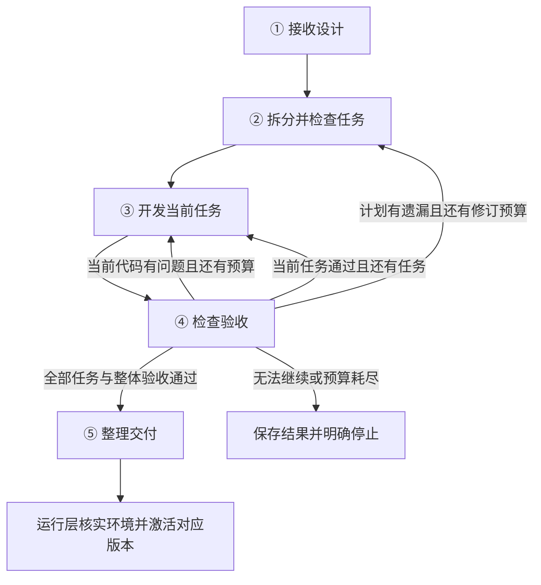

> 历史档案，非当前开发规范。本文逐字冻结 2026-10-25 整理前的 `docs/development-layer-design.md` 编年正文；来源为本机独立 docs 文档库在主仓库源码基线 `e4f1974` 下的原文件。当前研发规范见 [development-layer-design.md](../development-layer-design.md)，总体架构见 [ARCHITECTURE.md](../../ARCHITECTURE.md)。
>
> 原文含不同日期的迭代记录、已被后续规则覆盖的架构预算、迁移前源码路径及当时的外部参考。其中“当前”“必须”“首版”等均属于记录当时的语境，不得覆盖现行文档、当前源码与测试。保留失效链接是为了完整保存历史，不要求开发前阅读。
>
> 以下原文共 671 行，UTF-8 原始字节 SHA-256：`66098c1bc56ddac12a0531025a7f88f1badfeb9f7d2a9659fbee68ee533463ee`。本头部之后以“原文开始”分隔，分隔后的字节与归档前原文件完全相同。

<!-- 原文开始 -->
# NEUMA 研发层最终设计

## 2026-10-23 上游模块边界蓝图

上游新v3设计检查点只在蓝图确定模块职责、需求归属、输入输出和依赖，模块内组件和步骤在详细设计时补充。依赖模块按已保存上游的真实接口引用，组装核验所有者、依赖权限、引用存在性和循环，重名局部编号确定性映射为完整候选的全局编号。研发仍只接收通过完整程序检查和独立评审的最终候选，模块草稿与结构检查均不构成研发授权。研发五阶段、交接格式、预算和真实验收门槛不变；历史架构检查点保留原协议及累计用量。

## 2026-10-23 上游设计节点五轮

上游全新阶段化架构默认每节点五次、整条二十五次模型调用，旧检查点保留原额度和实际用量。资料读取支持批量逐项纠错，主要能力与后续义务理由按当前节点提供。该变化不增加研发五阶段或独立评审的预算，不接受未经完整架构评估的候选，不改变运行验收与交付门槛。

## 2026-10-23 上游手动重开架构测试

上游仅在用户明确要求下追加待启动架构记录，保留旧方案、评审与历史用量；用户手动点击后才从蓝图建立独立管线。待启动或未通过的新架构仍不能进入研发，研发阶段、预算和交付门槛不变。新一轮中断恢复不跨轮加载旧候选，后台重启不自动执行测试。

## 2026-10-23 上游历史问题关闭缺项

上游评审关闭历史问题缺少对应条款依据时，返回原文回执选项、稳定问题编号及缺失条款。合并草稿的诊断位置不套用到原始提交顺序，恢复时保持两者独立。模型显式补交同编号说明后重验，不将引用完整视为业务通过，不改变研发入口、预算与真实验收门槛。

最终分项提交集中反馈历史关闭缺项与完整报告中的检查、验收范围和阻断关联矛盾，接受成果须先通过这些校验。普通分批保存仍支持未完成检查；失败草稿和已接受进度保持独立。

## 2026-10-23 上游引用错误恢复

上游评审对超长引用集中返回具体路径、长度与真实子字段/分页回执选项，需模型显式选择并重验。检查点v4将引用解析前被拒的原始提交独立保存为不可信参考，恢复时重签当前引用与进度编号，原方案、已接受检查和累计用量保留。提交协议更新只解除明确已修复的旧引用错误停滞；同版重启或其他阻断不解锁，先续接已有余量，耗尽由用户显式开启下一轮。本变更不改变研发五阶段、预算或真实交付门槛。

## 2026-10-22 继续设计入口

上游独立评审的手动轮次耗尽、材料及来源完整时，提供“继续设计”按钮。用户点击后记录绑定当前版本与上一授权的新轮，最多五次调用，保留累计次数、原方案和全部检查；刷新、重启与重复旧点击不追加。该状态先补完未完成的评审，仍须正式独评、程序门槛及范围复核通过才能交接研发。旧记录保持原样，明确授权的新轮允许累计存储计数超过十二次，不改变研发五阶段和预算。

## 2026-10-22 上游评审引用与预检

上游评审优先选择原文字段，由宿主填入引用；历史问题可用本轮短引用映射完整编号，保存的正式材料仍使用规范原文与稳定编号。分项及完整提交集中报告引文、编号、结论矛盾和关闭依据等独立错误，保留已有成果与被拒草稿。自动引用不表示语义判断正确，不替代完整独评、程序门槛或范围复核；不增加模型额度，不改变研发五阶段及真实交付条件。

## 2026-10-22 修复后恢复上游手动测试

用户明确要求修复后恢复耗尽任务时，维护操作可建立一次绑定旧授权及七次累计用量的测试授权，追加最多两次、累计九次；先保存新版本，等待用户手动启动。普通构建不签发，重复点击或重启不补数，历史方案、检查和失败记录保留。两级来源均在模型前核验，完整评审与范围复核仍须通过；此维护例外不改变研发五阶段、预算或交接条件。

## 2026-10-22 上游被拒评审的可修正记录

上游独立评审在历史问题关闭依据不完整时，明确列出缺少对应关系的当前条款及说明字段。结构合法的被拒分项保存在与已接受分项分离的草稿中，允许用当前绑定编号局部替换错误行后重验全部内容；重启不重领额度，保存失败停止继续请求。草稿、单项保存及机械引用校验均不表示架构通过，只有完整评审、程序门槛与需求范围复核实际完成后才能交接研发。本变更不改变研发阶段、预算或真实验收要求。

## 2026-10-22 上游未完成评审的显式续评

修订候选已保存而独立评审因格式或引用错误在五轮内未能正式提交时，用户可通过一次“手动继续评审”授权最多两次追加调用。授权绑定当前候选、原版本及检查点，先落盘再请求；原五次和已保存分项保留，最多累计七次，独立范围复核也计入追加额度。重启不刷新，不能重复授权；完整正式评审、程序门槛和范围复核未通过时仍不能交接研发。续评不改候选，不重跑已完成设计阶段，不改变研发五阶段及其预算、独立评审和真实验收规则。详细条件及损坏来源处理见 ARCHITECTURE.md“未完成评审的手动续评”。

## 2026-10-22 上游 v3 架构三阶段交接

仅含 `draft.taskSpec` 的当前 v3 新设计使用蓝图、模块设计、整合三阶段：蓝图明确全局选择、最多三个模块的边界、依赖及正式需求分工，各模块补齐职责内的详细方案，宿主组装完整候选后由整合节点提交绑定摘要的受限修正。整合不能重写业务范围、模块归属或全局执行选择。已有完整待评候选及历史未分阶段记录保持原候选、评审和修订恢复方式，不因启用新流程重新设计或补充原评审额度。

`blueprint`、`modules`、`integration` 检查点保存已接受阶段成果、真实私有原生会话引用及累计次数，并绑定需求、平台、运行事实、反馈和提交契约。请求前先持久扣除预算；恢复同绑定进度只补未完成节点，已知检查点或会话引用缺失、损坏、错绑时明确停止，不新开会话刷新额度。三阶段共用十五轮，蓝图、每个模块、整合节点各最多三轮，整合预留三轮，模块最多三个且不能递归委派。正常工具续轮及压缩请求计入该累计次数；网络重试沿共享运行器既有策略，不叠加自写循环。

上游节点额度耗尽后，用户可显式授权整条设计唯一一次、最多两轮的局部修复。授权绑定当前版本、检查点及未完成节点，先落盘后请求，计入原十五轮总账并保留整合预留；原会话、已用次数和已接受兄弟成果均保留。结构合法的被拒模块可沿原生历史用本轮新编号局部修订，仍须完整校验及独立评审。授权不自动触发，重启或普通重新生成不能领取；二次耗尽或余量不足时停止，不放行研发。此例外不改变研发阶段或评审额度。

阶段保存和恢复均不表示架构通过或研发可启动。取消、截断、无响应、持久化失败与预算耗尽仍保留真实状态及已接受成果。组装后的候选继续经过原完整校验、独立评审、需求范围复核及后续真实执行验收；独立评估者的五轮、范围和返需复核各最多两次及其原扣数关系不变。研发五阶段、冻结用例、独立评审、隔离执行、激活与交付条件均不改变，未通过的新阶段不能成为研发依据。

上游组装候选时，由程序为跨模块重名的局部决策、验收、平台声明编号分配稳定全局编号，并同步声明引用；原模块成果和蓝图冻结的组件、步骤编号不变。模块内部重复继续拒绝，共享能力继续按原规则去重及整合冲突。全部模块保存后恢复仅续整合与评审，不因编号合并问题重新消耗模块轮次。研发仍接收实际通过完整校验与独立评审的最终候选。

新拼装保存`assemblyVersion:2`，同编号同状态的能力仅合并可完整保留的说明，真实状态冲突仍由整合处理。整合已耗尽且不存在待决冲突时，可在原会话只读核验及完整候选校验后保存程序完成标记，实际模型用量不变，仍需独立评审与范围复核。旧已完成整合保留原算法和摘要。合法来源编号同时核对冻结的需求引文与后续系统事项，只对唯一且有原文的消息别名规范编号；不能编造依据或删除验证义务。此流程不改变研发五阶段、独立评审或实际交付条件。

三阶段来源上的技术修订仅失效负责节点及依赖下游，整合仅补冲突和跨模块场景，已有有效模块承诺须保留。新代会话继续累计原十五轮及节点三轮，检索次数也在请求前保存并沿原证据摘要恢复。历史完整但没有阶段检查点的候选继续使用原局部修订路径。真实需求变化可以启动新设计且保留历史，不能把同输入重启伪装成新需求刷新额度。

## 2026-10-21 架构角色轮次

非三阶段的架构设计者和独立评估者各自最多 5 个模型轮次，续接不重置。范围复核与返需必要性复核仍各最多 2 次，计入发起角色这 5 轮。已按 12 轮保存的检查点仍可读取，已用次数达到 5 即停止。设计者一次构建最多委派 3 个模块设计者。新 v3 三阶段使用上节独立明确的十五轮设计总量；研发五阶段轮次不变。

## 2026-10-21 研发反馈与架构返修的连续闭合

失败研发的参考同时携带原来源评审、反馈和完整问题索引，不仅保存计划。最新工作区故障不替代之前的实质缺陷；明确绑定的上一代计划及评语一起只读续接。所有意见包含非阻断问题，原description与单列suggestedRemedy均标为不可信，建议可能错误或相互矛盾，不能成为平台事实或新的用户要求。首包有界摘要及完整分页入口保持，覆盖未知、来源损坏或超额明确不完整，不按无问题继续通过。

宿主在架构记录中持续保存`feedbackLedger`，独立于最新失败与模型对话。问题编号绑定原来源，不随D8/D9、位置、研发批次、中断或重启变化；旧评审一句已解决不能迁移成可信关闭。设计前发送未关闭问题，正式独立评审逐项决定仍存在、已修改或原意见不成立。相关功能正文未改、仅改理由/编号、无关新增实体或把原错误移到另一处，均不能声称已修复。关闭须有同问题编号的非阻断说明及当前正文的逐字依据；研发及平台问题另需关联当前平台声明和值，旧remedy不能充作证据。unsupported须反驳原问题，不是仅否定建议。

分项保存、完整提交、结构化提交、局部修订及恢复的主评审共用闭合门槛；缺少逐项决定或历史覆盖不完整的pass拒绝。有效关闭绑定关联正文和完整冻结来源，相关内容或事实变化重新打开，无关文案不触发重复闭合。来源覆盖按绑定累计，不同批次的完整空反馈不能清除旧的未知覆盖；账本或来源损坏保持明确停止。修订前快照按摘要共享，账本512KiB、未关闭问题80项，超限不截断；评审issues预留160项容纳历史解释和新问题，原分项/评审总字节、角色预算和研发五阶段不变。

未完成评审收到新待修反馈时，先交设计者局部修订，再独立检查，不重新评审原样旧方案。宿主保存唯一原版本、候选与检查点摘要及已花费次数，同候选四次仍从四次继续，十二次耗尽不会刷新。设计前中断、重启和新候选评审后的恢复均重核实际进度，坏来源不能退回零次；产品入口已经读取却无法核验绑定研发记录时，模型前停止，旧直接调用未提供记录时保留冻结参考兼容读取。完整评审结束移除恢复标记，不阻断用户正常修改需求。已经明确历史反馈覆盖不完整时，保存来源后在首次新模型请求前停止，避免为系统资料缺失消耗模型预算。

验证复用已有公开失败摘录、固定会话及本机隔离执行器：旧方案原样更名与假pass被真实评审提交入口拒绝；真实修改并补当前反证后重新经过完整独审和需求范围复核。固定实现与断言保持不变，错误字面mock参数执行失败，独立冻结精确JSON/CSV及完整性回执后实际执行通过。离线回放证明程序契约和具体纠错边界，不保证模型未来语义判断永不出错，不冒充原报销/Python案例已经交付。本轮不调用真实模型，不修改原失败记录和已扣预算。

## 2026-10-21 正式需求完整交接与容量

研发任务的requirementIds与架构正式需求共用容量：最多230条源需求和24条已绑定的后续验证义务，共254条。单个任务可以承担全部需求，但仍须完整映射架构验收、冻结断言、真实执行和独立评审；其他任务、文件、动作及用例数量限制不因此放宽。共享JSON Schema与宿主文本校验均按Unicode码点计数，分页与精确引文仍用原UTF-16单位，文件额度及序列化预算仍用实际UTF-8字节。

上游需求源头按紧凑JSON总量2MiB明确拒绝超量，保存及协商记录8MiB、主对话和需求会话32MiB分别核算；不再在研发之前被旧60000字符或HTTP旧128KB/512KB限制截断。整条交接保留完整需求与证据，首包有界摘要不替代只读完整材料。名称120字和后台单条消息12000字的限制同时贯通确认、保存与恢复，超量不修改原记录。

架构范围复核可以完整返回所有缩水项，正式否定仍阻断。新复核提交总量256KiB、输出预算受模型能力及需求条数限制；原累计请求次数不增加。冻结上下文按各来源原预算复制，主评审检查点按评审及证据分别核算，恢复不把聚合包误当单字段；证据连续分页接受宿主自己返回的下一页位置。旧绑定40条限制的原生会话保持原schema及原预算，不为更新容量重开会话；旧记录不回填字段、重算指纹或洗掉失败。

回归复用现有交付测试，在固定模型回答下将120项、超过512KB依据的需求从真实确认保存推进到架构、研发、激活、实际动作与完整文件读回；另验证254条任务映射、超量拒绝、非BMP文字、重启恢复及历史预算。固定程序实际执行与真实业务模型交付分别报告，本轮不消耗真实模型token。

## 2026-10-21 工具参数具体反馈

研发全部注册工具在SDK隐式类型转换前校验原始参数，复用共享严格结构诊断；提交、规划阻断、文件工具及材料编辑采用相同边界。反馈指出具体声明字段、应填与实际类型、当前枚举和上下限；多种可选格式按条目独立解释，不能要求模型混填另一种格式。无法唯一选择时返回有界替代结构。诊断保留总数、保留条数及截断标记，不回显参数值、动态陌生字段或SDK原始异常；既有规划材料问题台账、分页、冻结验收及业务语义诊断保持。

同工具、同契约与同原参数的连续三次结构拒绝，按原持久会话保存摘要和计数，在下一请求及排队执行前以repeated_tool_error停止。相同回复的重复预检只计一次，跨请求复用callId仍按已扣轮次区分；读取其他工具不清零，恢复会话不补预算。三次之前该工具实际成功可清零；三次后锁定等待诊断，不能由同回复后续有效调用绕过。只有公开工具结构变化使旧结构拒绝失效，原预算和五阶段不变。本机Pi流式替身覆盖错误反馈进入下一请求、修正后执行和重复停止，不以此声称真实模型或实际业务已交付。

## 2026-10-21 上游委派失败与请求拒发

架构模块顾问耗尽输出且未提交时，以module_output_limit阻断本次构建，保留模块编号、真实停止原因、已用回合、实际消耗回执和已成功成果。父会话在同条回复的后续工具入口、下一请求前及prompt出口保留首个委派原因，已排队的再次委派和正式提交也不能继续；不再依靠后续未知工具错误或接口错误定位。没有回执不推造消耗，失败模块不成为有效草稿；并行成功项仍经原版本核对保存，取消及迟到结果保持原限制。原五阶段、独立评审、累计预算和交付门槛不变。

共享运行器将本地模型请求拦截标记识别为request_blocked，以只读modelRequestRejection报告该请求未发出、受控来源和明确原因。原hook异常身份不变；取消、模块输出耗尽、产品轮次上限等既有确定原因优先，准入信息单独记录。真实测试护栏的请求数/输出预留停止需单列，不能混作产品预算或供应商网络错误，也不主动取消来覆盖原子任务失败。不追加真实请求验证这些边界；原生Pi与本机流式替身可检查主子实际请求参数及不再发出的上游调用。

## 2026-10-20 规划材料核验与可恢复评审

规划中的可选 `materialChecks` 只声明当前展开输入的数组数量、原字符串或规范JSON的长度和摘要，宿主计算实际值。文件写入模拟成功回执若包含完整性信息，必须与模拟参数中的明确正文一致；缺失旧字段继续兼容，模拟失败保持失败。结构化用例保存、规划诊断、正式快照创建前与执行准备共用此检查，错误不会通过先封存再执行变成既定标准。业务金额及顺序的正确答案继续需要独立依据，不能由被测实现输出倒填。

`caseFacts` 分开报告原输入文本、规范JSON、顶层内嵌文本及明确拒绝场景中的验证信封，避免把动作包装大小当成原始业务JSON大小。报告是材料测量，不等于真实业务、HTTP或MCP已通过。新v3架构可用 `platformClaims` 关联具体平台字段并只读核对；散文中的未声明假设仍需独立评审。

主架构评审可以保存按稳定编号组织的部分结果；来源、候选、证据及修订摘要必须匹配，恢复后只补缺项，原累计调用额度不重置。最终组装仍经过完整提交及独立复核，部分结果不能启动研发交付。旧完整草稿检查点继续兼容。

Pi统一读取本地模型目录或显式绑定的能力配置，不为品牌各写一套研发流程。未知模型保持保守文本配置；当前运行器支持OpenAI兼容接口，显式声明至少8192上下文，实际额度由SDK结合上下文计算。会话中的能力摘要不含接口地址或凭据，变更不替换任务身份或恢复预算。需求范围、返需和对话复核也使用同一按角色计算的思考输出额度及原调用次数上限。

## 2026-10-20 模型等待与无响应

研发及其架构、范围复核等模型请求不使用生成总时长截止。共享传输包装只检测连续未收到数据：等待首次响应时开始计时，响应头及每个非空数据块重新计时；持续返回思考、文本或工具参数时允许超过该间隔。默认90秒，兼容旧 `NEUMA_LLM_TIMEOUT_MS`/`llmTimeoutMs` 的配置值，但语义改为无响应间隔。工具执行、重试退避不消耗此间隔；正常结束、显式取消或后端关闭均清理计时器及在途读取。

无响应错误记为 `api_idle_timeout`，保留已有任务事实、检查点和累计轮次，不能把它当作评审否决或业务验收失败，也不盲目重发请求。重写、修订、网络重试及输出额度仍使用既有上限。实际测试命令、生成代码、托管服务和外部服务调用继续遵守各自执行及资源约束；本次模型等待调整不取消这些业务约束。

## 2026-10-20 上游评审续接与历史阻断关闭

五阶段、独立评审与冻结验收保持。上游架构新增`reviewProgressCheckpoint`保存未正式提交或语义被拒的完整评审草稿和原12轮累计额度；与已通过主评审检查点分开，不能当作通过或研发交接资格。直到第二次正文才结构合法时也保存，仍不增加一次提醒或自动提交。完全相同材料下重启续做，使用新修订编号，不重用旧证据回执；草稿与诊断合计最多256KiB。相关需求、候选、平台或依据改变后不沿用旧稿。

架构正式工具参数在SDK转换前统一校验。完整来源可按`{source,path}`选择具体短字段，由宿主恢复精确引文，语义充分性仍由独立评审判断。连续三次相同受控提交错误后不再发下一请求；计数与额度保存，同对象显式重试不能清零，换模型也不增加原额度。它只控制重复消耗，不让失败状态变成成功。

历史规划拒绝的“已修复”必须有可信来源基底及关联验收/实际适配器事实改变，无关编辑不能关闭。旧坏用例可用同findingId的非阻断说明及当前验收正文、实际适配器事实解释不适用，继续完整引用核对和独立语义判断。不会自动改真实案例、冻结断言或历史指纹，也不会把技术错误交给用户缩小业务承诺。

回归复用已有失败记录的最小公开模式，覆盖错误技术假设、合法输入误配拒绝检查器、评审不自洽、草稿续接与重复请求停止。模拟通过、真实模型通过、真实业务执行及正式交付分别报告，不能互相替代。

## 2026-10-19 全链路诊断、分工验收与不可变产物

### 原需求范围与真实宿主业务验收

桌面产物预览和完整下载分开：任务卡按智能体、任务及产物索引读取不可变快照，长文件仍能下载全部原始字节；快照预览只返回有界脱敏文本。普通工作目录的“下载当前文件”沿相同目录、禁名、链接及20MiB边界读取当前原文件，不能冒充某次历史任务快照。无独立网页但有动作的智能体也在既有产物窗口展示任务记录和逐文件操作，不再依赖打开业务网页才轮询任务。

评审首轮同时获得已声明组件和需求的稳定编号到真实路径索引；已有完整正文不要求再次逐字段读取。证据工具兼容单读及最多16项批读，片段与总引用字节有界。本轮候选来源的非根回执可用于候选位置，原文回执可用于来源；解析后继续执行同一真实路径与逐字核验，跨候选或来源混用拒绝。评审证据的独立错误汇总反馈（最多64项并保留总数），避免逐错重传。每次工具回执附实际剩余轮次，持久诊断仅保存读取命中、分页、重复计数与路径摘要，成功和未完成都记录，不保存读取参数或原文。

引文不匹配反馈可附同一真实路径的当前原文回执，仍由评审独立判断是否支持问题。结构完整、语义被拒的架构与评审稿可在当前角色内按草稿摘要局部替换已有声明字段；宿主重新核对完整结构与全部原语义，修改不自动通过，不增加预算，诊断不保存草稿原文。陈旧摘要、跨角色摘要、越界及重叠路径拒绝。评审技术中断后的正常新构建只可复用绑定未变、材料完整的历史待修订候选和有效评审，并记录来源；中断稿件不能成为通过依据。

正常文字结束且尚未正式提交时，架构、规划、开发、评审及两个内部复核至多在原会话提醒一次，使用原剩余调用额度。取消、错误、截断及额度耗尽不续；仍未提交明确记系统提交未完成。研发继续保留原持久会话及扣费记录。架构技术中断可从同版完整的历史尝试提取候选和评审，重新核对全部绑定、结构及原证据后作为修订输入；未评审稿不继承，旧状态和预算不改写。

流程总入口沿现有流程控制器执行，使用同组冻结的等待回复、批次及输出检查，不直接调用没有实现的总入口函数。步骤超时、缺少回复、取消及不确定的副作用继续阻止激活。输入契约拒绝在管理接口与网关共用受控字段诊断；输出契约错误显示安全的执行失败，真实业务验收将可修的代码错误送回原研发流程。

激活失败、取消或恢复未完成事务时，同时恢复旧活动定义并撤销本次新版架构的可用状态；撤销绑定架构版本、候选摘要和研发编号，不覆盖后来的版本。即使旧定义已被内层恢复，外层仍核对并清理匹配的新状态；普通历史版本回退不据此撤销原已交付版本。交付完成标记写入失败或取消时，研发记录及对应交付包的成功状态也按真实developmentBinding精确撤销；撤销写入失败保留preparing事务，读取显示待恢复并拒绝直接续接已完成状态。旧格式事务先原子保存已核实绑定，再修改定义或记录，允许恢复途中再次存储失败后安全重试。恢复旧定义仅保留当前memory/profile后续编辑，不合并新版权限或交付引用。

本机网关每次异步读取后的最终判断同时绑定授权修订号和活动交付。授权成功变更立即更新仅内存修订号，关闭中途撤权或换令牌的读取窗口；末端同步核对实际活动对象、代码及研发版本，过期请求不返回旧结果。主制作页不拼接内部方案和评审全文，详细记录仍可主动展开查看。

新需求的架构主评审准备通过时，另用无执行权限的独立会话逐项复核原输入集合和交付承诺。它只接收当前需求、确认来源、候选和冻结平台事实；类型、格式、字符集、规模、采样及拒绝条件不能因“保守实现”而自行收缩。结论绑定上下文摘要，新增限制须指出候选路径及同项需求的精确原文；缩小或尚不能证明时，主评审只能修订，不能通过。最多两次子调用计入原主评审十二轮总预算，失败明确为系统复核未完成，不转成用户缺信息。旧活动版本继续兼容读取。

验收适配器分别证明其实际范围。\`delivery-review\`核对绑定当前计划、代码及真实集成报告的独立计划/代码评审；不替代业务执行。\`host-business\`按计划冻结的\`activationChecks\`在隔离的真实Node/Python环境运行选定用例，使用真实文件及不可变任务产物，不用替身返回值冒充宿主行为。未知或有外部副作用的能力不能自动执行；缺少运行证据保持未验证。真实功能失败进入原研发修复流程，仍用冻结用例和原修复预算，重新执行通过后才可激活；失败不替换旧活动版本。

指南v2明确同一范围可组合多个冻结场景、关联要求可由多项证据共同覆盖。入口契约只证明拒绝；正向合法输入的内部任务准入由真实业务用例经过完整任务创建并执行后证明，仅对已选择实际输入有效，不等于HTTP/MCP传输或外部账号已验证。文件探针、环境健康、静态评审与真实业务执行不能互相替代。保留旧指南范围原文供历史逐字依据继续核对。

正向用例表示输入已通过入口结构并创建真实任务，不限定业务结论必须成功；满足输出契约且经冻结断言核对的约定业务拒绝也属于实际执行结果，未处理异常仍失败。九类适配器分别公开与实际执行器对应的执行事实和规则：动作测试可严格消费冻结的模拟失败回执，但不能据此证明真实宿主故障；真实宿主业务用例使用实际本机返回；目录探测、文件探针、环境探针、静态评审与对话观察各自保留原证明范围。新规则的逐字依据仅接受当前适配器适用的固定规则白名单，不能引用其他适配器规则或任意结构字段作为阻断依据。

候选与指南按来源manifest完整提供且长度、摘要吻合时，评审范围可直接提交当前验收编号及其实际适配器适用的固定规则路径。宿主从当前角色冻结材料还原原七字段，再执行原逐项覆盖、逐字出处和独立充分性校验；无须为已经full提供的每一行先读取并复制回执，也不额外占用回执额度。选择器严格四字段，不能与手写引文或回执混合；错误回执不自动降级为选择器，非full、错路径及来源损坏继续拒绝。旧详细格式与宿主签发的短回执继续支持：按当前验收编号选择本适配器适用的固定规则路径，宿主绑定角色、候选与全部来源摘要，提交时还原原来的适配器、范围及精确引文，再执行完整覆盖和充分性校验。详细旧格式继续可用，回执不携带通过判断。新评审另封存当轮指南及全来源manifest的精确快照和摘要；历史原引文用原快照重放，新候选仍按当前规则独立检查。旧记录缺快照且原文失配时继续拒绝或回退，不根据模型引文倒造权威来源。

下一轮独立评审接收有版本和对象绑定的历史问题清单，逐项说明已修复、仍存在或原意见不成立，并指出本次检查项及当前候选路径。历史意见不是新增需求，不继承旧通过；未解决事项必须有本轮阻断。同一候选及完整来源均未改变时，不能声称代码已经修改；判断变化须说明原意见不成立，变化另存本机诊断。没有历史问题的旧路径不增加该门槛。


规划索引的应用/服务错误与用例文件错误分别定位，语言、入口、依赖、运行方式及动作契约的独立错误一次反馈，避免Python入口写成JavaScript时只看到“用例缺失”。模块顾问额度耗尽后从后续工具目录移除，当前会话获得剩余额度及已有结果，不反复收到无法行动的结构错误。所有调用及修订仍使用原预算。


规划先保存包含任务、动作契约和用例文件引用的完整索引骨架，再保存小批用例。结构化写入即时核对入口契约、全局编号及页面检查适用性；原生工具可保留未完成草稿。`DevelopmentArtifacts.diagnose` 汇总全部独立错误，提供稳定编号、冲突两端、材料摘要、总数及分页（最多保留2048项）；正式提交仍冻结全组材料并执行原校验和独立评审。`edit_plan_cases`按编号与文件摘要局部增删改、重排未冻结草稿，每次单文件原子更新，冻结用例不可删除或放宽。

架构所有角色读取同一冻结 `runtimeCapabilityContract`（包含真实调用方式、输入返回、额度单位和脱敏边界）。新评审的阻断必须关联失败检查、候选真实路径和逐字依据；平台事实由宿主核对。程序拒绝候选时同时汇总独立的引用错误、重复、需求覆盖、验收覆盖、未使用组件及依赖环，保留总数和截断信息，避免首个错误遮住后续问题。无依据、检查全通过却阻断或遗漏问题的提交在原独立会话、原预算内纠正，不能自动通过。旧架构继续兼容读取，不重写历史指纹。 两个正式返需入口统一在接收结果前做来源核对和独立必要性复核，候选自行增加的限制、已回答事项、系统核实及未来具体输入返回当前会话修正；真正需要用户新取舍才写返需记录。独立检查最多两次调用，共用发起角色原十二轮预算；失败或预算不足记系统评估未完成，不能改写成用户缺信息。

新验收明确研发、激活或运行期及其真实适配器。`acceptance-contract.mjs` 台账绑定需求、架构、计划、代码和逐项证据。研发动作、输入拒绝、页面资源检查区分记录；主处理和交付不能全部挪到宿主或运行期。激活执行文件往返及不可变快照校验、实际隔离启动；缺少或失败证据阻止激活。网关默认为可选：仅实测尚未配置可让内部功能激活，同时外部状态保持待配置，失败不能冒充未配置。配置后真实HTTP/MCP目录检查更新证据，撤权/换授权使旧证据失效。目录检查不证明业务内容正确。后端已精确绑定的活动应用仅因可选网关待配时，界面保留内部聊天与功能入口，配置操作打开现有接口设置，不重新研发；外部网关台账仍保持待验证。无活动交付、版本或摘要不符、未完成及关键阻断状态不因此放行。当前已完成活动应用的继续请求只读取原交付，配置后通过独立的真实网关核验刷新就绪状态。

正常对话记录本轮实际工具回执，以独立、无执行权限的Pi会话核对冻结对话验收。最多3次模型调用，引用逐字核实，未触发、故障或证据不足保持待验；不相关下一轮不抹掉已完成场景。证据只在本地保存并绑定实际活动与交付版本，不能因为有一条成功回复就声称所有对话要求通过。

`files.write/read` 返回原始UTF-8字节的SHA-256、字节数和原文UTF-16长度；读取正文仍脱敏并按脱敏视图分页，回执摘要可核实全文保存而不把正文交给模型中转。每次动作写入把原始字节复制到任务独立私有快照，同名文件的后续写入不改变历史任务产物。管理下载和本机HTTP/MCP共同读取登记快照，按64KiB字节分页并复核大小与摘要。网关只接受当前授权、动作、任务、交付版本及产物索引，不接受任意路径；无快照旧任务明确报告不可用。

### 有界原生JSON与长度口径

动作的嵌套字段或数组items可显式使用空schema `{}` 保留JSON数据原形，根结构仍需声明原有类型。该字段受32层/十万节点、有限数、普通对象与密集数组规则约束，拒绝访问器、隐藏字段、非JSON值和循环；整个动作值、任务和网关的原字节上限不变。业务字段错误需要具体记录位置时，由生成程序校验这些原生数据，不把完整材料编码为嵌套JSON字符串。真实输入按实际映射后的序列化字节核算，封装和配置快照另计；JSON引号、反斜杠和控制字符的转义增长必须计入保守上界及边界测试。

`minLength/maxLength`统一按Unicode码点，与官方MCP的JSON Schema校验一致。JSON业务字符串和有效UTF-8工作目录正文可保留NUL，JSON标准转义和CSV原字段均无损往返；路径、源码及其他控制字段的NUL限制保持。文件写入及读取分页仍以UTF-16单位计，不能把业务字符数或原字节数替代文件单位。普通读取继续严格UTF-8解码、正文脱敏及原字节完整性摘要；含NUL的任务产物预览仍提示下载，完整原字节下载不受影响。目录授权、链接拒绝、原子写入和大小限制均保留。能力事实摘要随真实行为更新，历史记录不回写。

新的运行机制能力单独冻结并显式提供给架构目录，表示平台已有实现，不表示某一交付已经通过实测；这些机制不会注入工作工具列表。每条正式验收必须由独立评审核对其实际适配器的证明范围；检查健康不能证明整套业务测试通过，文件往返不能代替最大规模和业务内容验证。原研发阶段的后续义务必须保留原阶段覆盖。

评审可调用只读证据工具获取绑定当前候选、上下文和角色的引用回执，再提交回执编号。宿主还原精确原文引用后执行原验证，未知、过期或跨候选回执拒绝，不把便于引用改成自动通过。

## 2026-10-19 容量依据续接与 Pi 原生研发

五阶段及两种角色保持不变。Pi 提供模型工具循环、网络重试、原生文件编辑、持久会话及上下文压缩；NEUMA 继续负责版本、授权、预算、真实测试、独立评审和交付。当前实现入口为 `development-sessions.mjs`、`development-artifacts.mjs`、`development-file-tools.mjs` 及运行封装 `pi-session-state.mjs`，不另建一套模型循环或通用会话摘要恢复器。

新范围复核的full-v2上下文与主评审使用同版完整延后验证记录、证据、材料摘要和平台快照，包含已核实的连接测量及阶段决定；仅传问题摘要不足以复核。统一构造器用于发送及否定反馈的恢复，并将版本和事实绑定到contextHash。历史无版本原生记录继续按原上下文重验，不回填、不新增原候选预算。历史问题的反证闭合在重新读取后可用同源冻结上下文核实，候选或材料摘要变化则拒绝。主检查点和原生历史仍不能自行授予交付状态。

full-v2范围提交用稳定需求编号选择requirements原文，长文本由模型明确指定UTF-16摘录范围，宿主不猜测或自动纠正引用；草稿和确认记录仍检查真实逐字来源。新工具协议与历史详细协议分别绑定schemaHash，保存后的证据仍沿用canonical结构。实时提交不能冒充存证回读绕过新协议。范围复核区分真正减少业务承诺与系统实现、验收细节；没有证据的技术缺口继续保留，合法延后的验证不被记为已执行，也不因尚未执行直接判业务缩水。

### 需求阶段交给研发的依据

上游架构重试不会把旧评审当作通过：显式重新构建仍新建版本、保留每版原两轮上限。只有前版为 `needs_changes`，候选与评审摘要合法，需求及指纹、平台、已确认来源和后续义务全部一致，才向新设计者续接上版候选和具体问题。历史来源和修复意见由 `revisionSource` 绑定，不产生新业务要求或权限。新候选经本轮程序校验与独立评审通过后才交研发；条件改变或记录损坏时不续接，旧版本不改写。

设计者、独立评审者和模块顾问读取每版构建一次生成的 `candidateSchema`，等于设计者实际提交工具的参数结构；只读参照用于判断需求和候选的字段类型、必填及允许字段，不让评审者据需求字段形状要求无效的候选结构。结构规则仍由程序检查，业务判断保持独立。

当前交付证明范围由宿主 `requirementProofScope` 绑定需求、平台和当前事实。规范 API/MCP 信封见证说明存在合法的提交方式，完整外壳仍受真实入口额度约束；可选元数据增长和未来配置变化不自动扩大本次交付承诺。B 表示映射后的真实动作入参序列化字节，业务材料转成字符串字段时须另计转义与对象外壳，不能用材料字节上限代替。研发冻结所选映射并验收边界。当前未知事实仍可阻断；已知事实的冲突需要同范围真实反证，其他未覆盖要求须引用当前事项原文并独立复核语义。

预评估完整传递历史计算回执，旧评语与当前证据分开。程序先重放算术，再根据相关要求、平台字段、同问题可信核实与未决范围的宿主摘要判断当前适用性；新回执采用 v2 绑定，旧回执及旧需求指纹不重写。相关条件改变只使受影响计算失效；连接封装发生变化时，没有相应连接事实绑定的旧计算不能冒充当前证明。回放不消耗新的核实调用，新计算与资料及宿主检查仍共享两次总额度，全部模型交互仍共用六回合。

`trustedFacts` 从宿主已知输入封装契约和当前连接测量中投影，保存实际值类型、来源摘要、事实编号和适用范围，不把任意证据正文中的 JSON 当可信事实。带历史计算且继续阻断的事项，有当前事实时须列出具体未知、解释冲突或未覆盖范围，已 available 的事实不能再次声明 unknown。`hostExecution` 将本轮实际计算次数、新发回执与续用的旧回执分开提供；事实可用、算术正确和整体方案可交付仍分别判断。

带有历史计算的系统阻断必须由独立决定说明当前依据摘要、已经证明的范围、仍缺前提和下一项系统动作。程序发现失效引用或缺少当前进展，在原预算内最多纠正一次并再次独立复核；不足以完成则报告系统评估未完成。不能通过换用户回答、缩小业务要求或自动放行来结束技术阻断。正常充分、待用户补充和继续阻断也保存受控调用次数、采用/失效回执、停止原因和待做动作。系统计算通过与研发、激活和真实业务验证分别记录，后续义务继续进入正式需求覆盖、计划与冻结用例。

### 规划材料与正式计划

任务按实际职责分配验收条目，完整计划要求每个 `(task.id, acceptanceId)` 组合都有两者同时匹配的执行用例；其他任务的同项用例不能替代当前任务。此规则同时写入公开计划字段说明和规划提示词。跨任务条目可由依赖完成后的集成任务承担，避免无必要的重复分配与用例膨胀；程序覆盖检查及冻结断言不变。

结构化与文本模式都从实际 JSON 根核算同一深度、节点和字节额度，参数外壳用属性描述符单独核对，不执行访问器。保存回执的 `planningIndex` 是宿主按内容计算的事实，自定义索引在两种格式中均可被自动预检识别；这不等同于计划内容已通过校验。

用例文件优先使用 `save_plan_cases({path,cases})`。cases 必须是非空原生数组，公开 items 直接沿用控制器本轮 v2/v3 计划中的用例结构，不另维护一套格式；宿主核对结构、有界复制并生成 JSON 文件。该入口不接收或自动解析字符串批次，省去整批用例的额外字符串转义；每个用例内部的输入、替身和断言仍遵守原文本/夹具规则。索引继续使用 `save_plan_json`，旧写入路径保留兼容。新工具与原写入共用整组锁、权限、配额、取消和完整预检，正式冻结、验收和独立评审保持。

严格用例入口通过内部 `rawInputValidators` 在 SDK 实际执行前对原参数做同源、禁止类型转换的结构检查；不能使用已被转换的 `tool_call.input` 代替原参数。原参数来自当前助手消息的唯一同编号、同名调用；只用 WeakMap 缓存受控校验结论，恢复时回查同一当前消息重验，缺失、重复、错名或嵌套调用均阻断。数字 input/expectedJson 不能被 SDK 自动转成字符串后保存；合法夹具仍按原规则接受。反馈不包含原始参数或异常正文，不额外持久化原文；非严格工具保留兼容行为，预算与冻结门槛不变。

新 v2/v3 规划者仅在独立 `development/workspaces/<runId>/planning/` 目录写 JSON 数据。索引保留 summary/runtime/entrypoint/tasks/application 等现有计划字段，把 cases 换成有序 `caseFiles`，可选 `activationCaseFiles` 对应独立的启用前用例；每个引用文件可以是一条普通用例或一批用例数组。两个集合共用全局唯一编号和200例总额。`submit_development_plan` 只提交 `indexPath`。先准备材料，再提交引用；格式修正可以只编辑对应文件，不需要重新发送整份计划。

优先通过 `save_plan_json({path,value})` 保存对象或用例对象数组。value 公开支持直接结构化数据和完整 JSON 文本；文本严格解析一次，解码后的根必须为对象或数组，再走相同有界复制、宿主编码和原子保存。回执 `inputEncoding` 明示 structured/json-text；不修补非法文本、不二次解析、不接收解码后的基本值。`update_plan_json({path,updates,expectedHash?})` 在整组锁内按有限 JSON Pointer 精确替换已有字段或数组条目，重新序列化后原子保存；拒绝原型路径、不存在路径、重复与父子重叠更新，限制深度、节点、更新数与字节。不会执行访问器或 toJSON，数据中的普通字符串键保留。读取与版本核对均使用原始字节摘要，包含 UTF-8 BOM。原生 read/write/edit 仍可用，所有写入沿用同一权限、额度和完整预检。

`DevelopmentArtifacts.submit` 与原生编辑共用整组锁，先封存整个文件集合到只读快照，再组装原计划；缺失或重复引用、重复用例、非法路径、链接及不完整 JSON 均拒绝，不自动修复。材料原始额度为单文件 2 MiB、总量 10 MiB、最多 201 个文件和 200 个用例；索引单独占用一个文件，不能误套代码的 200 文件额度。此额度与声明式夹具每次计划或验收展开 16 MiB 分别核算。

规划共用宿主 writer 在创建临时文件或覆盖前，严格解析最终内容并要求对象/数组根。原生 write/edit 也不能将有效材料改成坏 JSON；拒绝时原文件保持，后续精确更新可继续。此处只检查文件语法及根类型，不要求一次写齐计划字段或引用，合法空对象可渐进补齐。旧记录或外部损坏文件在读取、预览和封存时仍核对，不能因写入前检查而跳过。

每次规划 write/edit/save_plan_json/update_plan_json 完成后，宿主调用 `DevelopmentArtifacts.diagnose`，在同一整组锁内捕获当前材料的完整字节集合，复用相同组装规则和完整 `validatePlan`，在该工具结果的 `planDraftCheck` 中立即提示 incomplete/rejected/valid。引用缺失时保持未齐状态；覆盖不足只用受控任务和已批准需求、验收编号说明映射缺项，便于局部修正。预览不创建目录、不改变权限、不封存正式快照、不推进阶段，也不额外请求模型；`planDraftChecks` 最多保留 24 条状态、材料摘要和安全问题，不保存原始 JSON。即使预览 valid，模型仍须正式提交索引，宿主重新封存不可变材料、完整校验并进入独立评审，不能绕过任何正式门槛。

组装后仍执行同一 `validatePlan`，修订继续传入 previousPlan，覆盖、依赖、实际输入、动作、能力替身、冻结规模与断言保护均不降低；独立评审检查同一完整计划。开发者的代码工具不能访问或写入规划材料。消费待审计划和恢复研发时，重新核对只读材料快照、计划摘要、当前架构及任务定义。旧 v1 直接结构提交和已交付记录保持原协议读取，不因新材料机制重算历史摘要。

未接受计划且尚无任务执行的失败规划，另封存为 `planning-draft-snapshots` 私有快照；该快照不是正式计划。明确开启新研发批次时，只有 Agent 和完整架构事实摘要完全相同，才逐字恢复至新的空规划目录，并按当前结构及实际空代码工作区重新诊断。首包标记 `historicalPlanningDraft.trust=unverified`，给出旧批次来源和当前检查；模型须主动修改、正式提交并通过独立评审。只复制规划 JSON，不复制代码、旧 Pi 会话、预算或验收结果，也不自动启动下一批次。同批次继续仍用原预算；旧无草稿快照记录只有实际材料摘要与最后检查一致才可补封存，不从模型历史重造。损坏、链接、所属不符或目标已有材料均拒绝恢复。

该首包同时给出历史相对文件清单、字节数和 `fileHash`，不附全文或私有路径。规划者可用 `read_plan_file(source="previous")` 精确分页读取当前记录唯一绑定的历史草稿；`restore_plan_file` 显式恢复同名文件，要求历史源 `expectedSourceHash` 和当前目标 `expectedHash`，目标确实不存在时才允许明确为 `null`。每次读取或恢复均重验所属、固定快照目录、整组实际字节摘要及文件清单，恢复共用规划锁和原子写入；已接受计划不提供该入口。恢复不复制接受状态，仍返回当前文件摘要、完整规划诊断，并保留正式封存和独立评审。

`save_plan_cases` 覆盖已有合法批次时须保留全部稳定用例编号，不能用两个修改后的用例静默覆盖完整批次。需要删改时通过带当前文件摘要的 `edit_plan_cases` 显式执行，宿主不自动合并或改断言；坏 JSON、结构损坏及同编号重复草稿保留明确修复路径。任务编号及该任务的验收归属在结构化写入前检查，拒绝回执一次给出当前索引的有界真实任务与需求、验收编号。动作值共享 `TEST_JSON_VALUE_GUIDE` 区分实际业务 JSON 文本和原生夹具对象，夹具外壳不能二次编码，宿主不递归解码。

分页明细同时携带有界问题分类及数量，防止大量同类错误遮住其他独立问题。数组断言路径错误明确使用 `errors.0.code` 形式；任务信封拒绝用例反馈同源测量的当前字节数、上限与目标。通过宽松动作契约的输入明确要求核对已声明的输入约束或真实业务执行；不自动替换用例类型、输入或预期。读取不存在的资料字段时，仅列当前可用顶层字段名，不返回字段内容。

原生及结构化规划写入回执同时提供 `fileState.fileHash` 与整组检查的 `bundleHash`，分别用于局部修改与诊断分页，避免写入后还需读回才能获得正确的修改摘要。配方限制反馈按同源额度说明 repeat/text 的 count、配方节点及展开限制；保留原测试规模，不自动缩小数据。

局部用例写入只以当前用例结构、索引分组、动作输入与用例身份等相关检查阻断；索引中其他应用语义问题以 `indexDiagnostics.status=rejected` 明确随回执返回，不阻止当前合法用例的保存。正式提交和完整计划诊断仍验证全体应用配置，保存草稿不代表计划通过，不能以该机制绕过流程、入口、权限、依赖或独立评审。

正式候选尚未获独立评审通过时也可续接未信任材料。历史评语须核对实际计划摘要和独立评审 subjectHash，标明其原批次及被评计划版本；不把评语当作当前证明。跨多次未通过草稿续接时，重新从原研发记录核对评语绑定，不依赖模型摘要或把旧评语冒作新判断。当前计划评审另收到绑定 subjectHash 的 `admissionFacts`：生产同源校验器对冻结拒绝用例实际展开后的目标、字节、限额、是否拒绝与 actionExecuted=false；这些事实只证明入口行为，不能替代业务质量与真实执行验收。

计划评审的版本摘要由共享 `plan-review-subject` 构造，评审创建、历史核对及最终交付使用相同算法；新记录标记 subjectVersion=2，将当前实测事实纳入摘要。旧无标记记录按已知完整格式精确匹配，未知版本或篡改事实不通过，不重写历史摘要。首包在预算容纳时优先提供完整被评计划及实际需求；`admissionFacts`、`planningWorkspace`、`acceptanceAdapterGuide` 在大型通用结构前完整填充，避免有剩余空间却仍需分页补读。原长度上限、投递来源和会话复用证明保持不变，未容纳字段仍可精确分页，不限制模型主动核对原文。

研发规划和开发请求 `reasoningMode=auto`，独立研发评审请求 `off`；主架构评审、需求范围复核及对话验收也请求 `off`。已有完整候选的架构技术修订及其委派顾问使用 `off`，包括同次构建第二次修订；全新设计及其顾问保持 `auto`。这是共用的Pi角色运行策略，不按品牌选择协议，也不改模型支持思考的能力声明。SDK按真实模型支持档位处理该请求；强制思考的模型可能只能使用最低支持档，不能保证产生正文或正式提交。Pi继续管理原生历史，思考原文不进入界面或安全诊断；真实引用、独立验收、长度失败及零进度停止保持。模型调用、压缩及重试沿用原预算记录，输出上限未提高，模式变化不重置任务或会话预算。

未接受规划的研发次数或修订额度耗尽时，服务端摘要提供绑定当前批次的 fresh 续接方式。界面显示“新一轮研发”，只有用户明确点击才创建新批次；刷新不启动模型。仍有额度、中断或已经执行任务的记录继续原批次，不静默重置预算。所有旧记录保留；新批次是否能复用未信任草稿仍由私有绑定和快照校验决定。

启用前的业务用例可在 `activationCases` 单独冻结，绑定自身的 `host-business` 验收条目，不计入研发任务及研发通过数量。`activationChecks.caseIds` 可以组合既有研发用例及本项专用启用用例；后者由完整计划的独立评审核对断言与本项预期，并在启用前使用真实宿主执行。不能为了满足编号覆盖，把专属启用义务改成研发已验证。两个用例集合、来源、目标、输入、替身、断言与分组映射一起冻结；修订不能搬移、删除或降低原验收。

`activationChecks.executionScope` 缺省为 `isolated`，保持历史每例独立范围。显式 `shared` 按冻结的 `caseIds` 顺序复用数据和文件范围；托管服务还复用同一后台进程，用于检查跨调用残留与恢复。内置动作与正式执行一致，每次仍启动新的隔离进程，不能据此声称检查常驻内存；分组结束再清理。共享组原顺序不可改写，允许在末尾增加用例。相互独立的进程测试不能冒充同一进程连续调用证据。

正式规划提交失败也返回同一完整、有界问题台账，包含材料摘要、来源文件、稳定用例编号和分页位置；不再只返回最先触发的错误。任务映射错误标明实际索引文件、最少条目和实际条数；每个任务须承担本地可运行的验收，集成任务不能替代前序任务。首次规划仅在宿主实际快照证明工作区为空时，按正式调度器同源顺序前检入口文件是否及时存在；非空重规划及旧计划读取不套空工作区假设，原代码、任务状态及冻结用例仍受原规则保护。原生编辑未匹配或匹配不唯一时文件保持原样，应读取或按编号与摘要局部修正，不能重复提交未变化材料。预算仍按实际模型调用扣减。同一不合格材料摘要重复提交仍完整校验并扣原预算，反馈只保留未变化事实和重新读取诊断分页入口，避免反复堆叠相同问题页；材料改变后重新返回完整诊断。单文件、整组及单用例分别公开fileHash、bundleHash、caseHash与hashScope，原hash兼容保留，CAS不宽松接受错误作用域。目录中未被索引引用的文件只作有界提示，不自动加入用例；追加批次须保留原索引引用。字符串形式的配方外壳只在正式动作契约确实拒绝时说明编码不符，不递归解码或修改输入及断言。

架构与研发显式控制器共用与模型品牌无关的结构化提交通道：正常结束时唯一完整JSON对象，必须严格匹配本轮明确开放的终止工具参数，或使用 `{submission:{name,arguments}}` 指定其中一个出口。宿主禁止类型转换并执行同一提交处理器、版本检查、语义校验、独立评审及真实验收；完整候选和带当前编号的局部修订可直接提交，不为重复转成工具调用额外花一轮。读取、写文件、搜索和外部操作不开放正文执行，未知工具、批量指令、歧义、异常结束、截断及围栏均不执行。边界为256KiB/32层/100000节点。临时草稿编号保留兼容读取；`submit_architecture_draft`仍消费一次性编号并重跑全部检查。编号绑定角色、提交工具、上下文、候选及本次尝试，不跨会话复用；异常、截断、围栏或混杂文字、旧回复、无效结构不暂存。正式提交、局部修订、返需和结束会清理临时槽，既有被拒稿修订槽独立保留；原12轮预算与一次提醒不增加。未暂存时区分解析、正文形态、大小及原结构校验原因；既有唯一提醒带安全诊断，最后一轮也保留未提交原因。最近至多两条、每条1024字符及四个声明字段问题，不保存正文、陌生字段或原始异常；结构化结果正式提交仍不等于评审或验收通过，不增加原预算或提醒次数。

架构修订先合并核对同一字段的全部建议，避免建议相互冲突；每条范围判断只检查自身expected。实际动作身份绑定与完整目录或全部静态配置映射分开，前者不能外推后者。历史方案前的新构建若在产出候选前中断，可越过其初始契约标记继续严格扫描历史待修方案；只对受控designer/designing中断且候选、摘要、评审均空、attempts为空生效，所有需求、平台、来源和后续义务绑定保持，历史状态与预算不改写。

独立需求范围核对沿用相同严格判断与两次模型上限，格式和语义诊断分开记录：需求编号唯一/齐全、候选与来源路径、逐字引文、保持/缩水标记与结论一致性各有固定字段和原因。单次最多40项并记录真实总数及截断，反馈最多14000字符；允许编号表只在顶层有界提供，不输出原始值、引文、异常正文或陌生字段名。失败诊断通过架构角色原有保存路径保留；首轮被拒、次轮成功也保留先前安全诊断。截断、最终连接异常与取消保持未完成，不增加调用或自动判定范围保持。SDK原生网络重试只有在已开始重试、明确成功且当前回复完整时才清除先前临时错误；失败、截断和取消标记不清除，网络重试不重复扣业务调用预算。

### 首轮资料、编辑与安全诊断

新规划及 v2/v3 开发复用 Pi 原生 read/write/edit；真正的文件操作由宿主注入。代码仍按任务精确文件清单授权，规划仅允许本目录的 JSON；两者都拒绝越界、符号链接和硬链接，写入原子发布，并与快照共用各自锁。原生编辑可在同一文件中执行多处精确替换，不开放任意宿主 Shell。原有精确字符分页继续处理超长单行，代码的旧 v1 工具保持兼容。

首轮先按角色筛选，再受模型窗口二分之一约束：开发最多24000字符，规划/评审最多64000字符；未知模型仍按32768窗口限制。规划优先当前架构和正式需求，开发优先当前任务的需求、验收、用例及依赖接口，评审优先当前计划/代码对象和真实报告。开发保留依赖步骤、组件及相关交接，不因输入筛选减少程序实际执行的全量回归。详细角色规程、平台说明及完整schema按需读取，不在主提示和首包重复展开。

`contextSections.delivery` 区分full、summary、paged；任务子集与不完整摘要均标summary，不能冒充全量。完整字段无需重读，其他字段按实际需要通过`read_development_context`的section和可选JSON Pointer精确读取，原分页继续可用。完整需求、计划、用例、后续验证义务、历史和来源绑定不改写；仅投递方式发生变化，缺少依据仍须读取或保留未验证状态。

同角色、同绑定的持久会话恢复时，宿主用字段摘要和实际用户消息摘要核对投递回执；只有原完整消息仍在 Pi 当前上下文，且该消息之后已有完整成功回复，才以 `delivery=session` 复用未变字段。新反馈、变化字段和实时预算仍发送实际值，完整事实继续由原分页工具精确读取。回执不保存正文或私有会话路径，不重置预算；任务子集不签发整字段完整投递回执。旧记录无回执、绑定变化、消息缺失或压缩后仅剩摘要时保守重传本角色所需材料。原生 `context` 扩展在每个实际请求前再次检查：若 `prompt` 内部或工具续轮的自动压缩移走原文，按同一角色投影恢复资料，不退回全量灌入、不另发模型轮次、不伪造持久历史。

首轮提供 `modelBudget`，工具执行后附加实时 `hostModelBudget`，均由宿主计数，提示当前角色上限、已用和剩余回合。规划指引要求合并小批材料、尽早提交完整候选，在原预算内预留至少两轮处理程序拒绝，不借此增加回合。`read_development_context` 将预算信息合入原第一个 JSON 文本对象，section/text/offset/nextOffset 等分页字段保持原值；其他工具追加独立预算文本，不改动已有工具结果。业务账本继续是预算权威来源。

诊断对照解析前后已声明字段的类型、长度、结束原因及提供方实际返回的用量，不保存原始模型参数、动态字段名、业务内容或凭据。SDK 校验拒绝后的模型反馈也替换为受控字段和修复建议；新结构化工具指出非法字段或类型，合法 JSON 文本按公开协议严格解析，不修复错误内容。动作用例反馈展开后的预期及实际根类型，区分完整动作入参与其中的业务文本。解析用例值时由宿主附固定字段及用例序号，非法 JSON 断言可直接定位，并提示使用原生 JSON 编码或有限 value 夹具，不自动改变断言。规划材料错误定位索引类型、有界 caseFiles 序号及安全行列/字符偏移，不返回异常正文。受保护的 Pi 原生工作历史继续用于恢复，与安全诊断分开。自动化验证及固定 Node/Python 程序的平台闭环不等于真实模型已能完成代表性业务案例，后者仍须实际创建、验收和交付结果确认。

## 2026-10-19 提交契约与失败证据

架构声明无需代码且使用宿主内置能力时，不允许进入代码研发；若页面、专属动作或工作流仍要求代码，由架构层解释并修正一致性，不能在研发层虚构任务。已有宿主文件工具保存文本不等于新增后台功能，已确认操作有误时先正式返需。

规划上下文公开当前应用清单和完整计划结构，页面可明确为 null；示例使用合法 JSON。新 v2/v3 通过材料索引提交，组装结果仍按同一结构检查，旧 v1 继续直接结构提交。规划、实现和独立评审提交的 SDK 格式拒绝及内部契约拒绝分别计数，并与阶段检查点一起持久保存。诊断只记录已声明字段路径、受控原因和修复建议，最近记录最多 24 条，最终失败附最近最多三项原因；不记录原始提交内容、动态字段名或密钥。没有提交证据的历史失败继续如实报告未知，不把模型回合数当成提交失败次数。

模型提交被拒后，收到与保存记录同源的安全 issues 列表，包含固定字段路径、原因与修复建议，不收到原始异常正文。入口、动作输入等错误有精确受控反馈。新动作用例的 JSON 值超过原文本长度时，提示保持业务规模与原预期，改用上下文 testFixtureSchema；普通文案、旧 node-json 及 node-check 不适用夹具建议，不能借格式修复减少边界测试。

v2/v3 动作用例使用共享形状表生成公开计划结构中的条件必填规则，内部计划校验读取同一形状表。普通 action（也包括历史省略 kind）必须提供 actionId、mocks 且不得指定 entrypoint；node-check 必须显式 kind、独立 entrypoint、文本 input/expectedJson，不能填写 actionId/mocks；input-rejection 必须显式 kind/actionId、空 mocks，不提供流程回复。空 workflowInputs 保留既有兼容，仍需通过冻结流程关系检查。新文件提交先组装再检查字段及完整语义，模型在原预算内修正材料后重交，随后才进入独立评审；旧直接结构提交继续使用 SDK 前置形状检查。不增加格式重试额度，不改旧 node-json 协议或执行器。

输入输出 schema 的允许类型、关键词、适用范围、属性名称与数量、枚举和数值/长度边界使用 `VALUE_SCHEMA_RULES` 与实际校验器同源；根深度为 0，子结构深度最多 12。生成说明只进入 application.actions、service.operations 的工具字段 description 和新版公共上下文 valueSchemaGuide，规划、开发、独立评审共用。实际用户 schema、manifest 及其摘要保持原内容，仍通过现有严格校验；不把开放对象字段解释成任意 JSON Schema 支持，也不新增递归元结构。

规划提示词的完整范例分别演示正常动作、输入结构拒绝和合法结构中的业务拒绝。比如字符串不能冒充整数数组时由平台拒绝；整数数组中的重复项由程序返回约定错误码与位置。用户要求的位置、原因与完整性断言不能被固定的 input_contract_rejected 替代，冻结用例不自动换型或降级。Node 输入拒绝证据显式保存 exitCode:null、stdout/stderr 为空及 actionExecuted:false，既不运行目标进程，也不伪造 exitCode:0；证据可以按原严格 JSON 摘要封存、送独立评审并随交付激活。

恢复中断研发时，已有计划仍须按当前冻结架构重新校验，不能凭同一架构编号跳过新增门槛。无代码方案在研发接收阶段即停止，保留源码、进度和剩余预算；已完成且已激活的旧交付继续沿兼容读取路径返回。

以上检查不增加原模型预算，不降低真实执行、独立评审和版本交付门槛。

### 大样本与输入拒绝验收

动作用例的 input、能力替身 argsJson/resultJson、断言 expectedJson 保留原 JSON 文本，也可写成 `{fixture:节点}`。规划、开发和独立评审共享 `testFixtureSchema` 与 `testFixtureLimits`，不要求模型把边界数据逐条写满计划。有限节点支持 value、object.fields、array.items、repeat(count,value)、index(start,step,prefix?,suffix?)、text(value,count) 与 json(value)；index 只在最近一层 repeat 内生效，数字精确计算并检查安全整数，前后缀生成字符串。没有脚本、表达式求值、文件或网络能力。

配方最多 12000 UTF-8 字节、256 节点、12 层，重复次数最多 10000、展开节点最多 100000；普通 JSON 值最多 1MiB；仅 input-rejection 的输入允许有界展开至 1MiB+64KiB，使超限负例能抵达正式拒绝校验器。断言、能力替身与实际动作输入限额不变。每用例新夹具合计 4MiB，每次计划或验收合计 16MiB。生成过程支持取消并提前检查输出大小。node-action 原 128KiB 输入限制继续执行；托管服务仍走原输入与控制通道限制，夹具不扩大正式业务协议。旧计划、node-json、node-check 的文本输入与断言保持兼容，不在读取时重写用例或摘要。

计划保存配方而非膨胀样本。修订按内容摘要冻结输入、替身和夹具断言，等值输出不能作为替换原配方的理由。验收报告仅在使用夹具时追加字段路径、配方摘要、展开 SHA-256 与真实字节数，并用真实隔离 Node/Python 调用实现；能力仍精确匹配并逐次消费替身。摘要证明样本身份，业务是否正确仍由实际输出断言和独立评审判断，模拟文件/连接不证明真实外部业务服务。

非法动作输入采用 `kind:"input-rejection"`，引用实际动作、有效 JSON 输入及空 mocks。`inputTarget` 缺省为 `action-value`，使用同一 `validateActionInput` 检查动作值；显式 `task-envelope` 使用与真实任务仓库共用的 `validateApplicationTaskEnvelope`，只检查固定合法验证信封的128KiB JSON大小。后者不证明业务结构、任意未来元数据或HTTP/MCP传输。报告保存实际目标、字节和上限；错误目标不能冒充正确拒绝。结果为 `{rejected:true,reason:"input_contract_rejected"}`，报告明确 `stage:"input-validation"`、`actionExecuted:false`。不运行目标代码、能力或流程回复，不能替代每个公开动作以及迁移/验证动作的真实执行用例。合法输入中的业务负例仍由普通 action 执行并断言约定错误结果；崩溃或无关失败不算正确拒绝。超过既有传输边界的样本仍拒绝，不能靠此用例伪造协议支持。

需求阶段经独立复核留下的研发、激活和运行时验证义务，必须绑定当前充分评估、需求和平台；正式架构将其转为 verification_ 覆盖项及具体验收，研发事项继续要求任务和实际用例；激活与运行期事项进入对应待验证台账。规划、开发、评审和分页上下文均提供完整 deferredVerifications。研发验证代码，激活验证真实环境和启用后的接口，运行时核实具体输入；尚未执行的后续验证保持待验证，不因后移或模拟测试被宣称通过。新义务出现时不复用缺少该义务的旧候选；候选失败仍保留旧活动版本。

## 2026-10-18 通用需求依据与受管服务交付

本轮保留接收、规划、实现、验收、打包五阶段，新增服务执行适配，不把代码写出或模型自评当成运行成功。新需求的 `taskSpec` 六维要求在正式架构中成为稳定覆盖条目，研发任务与验收案例必须继续引用；架构 v3 的 `selectionBasis` 解释规模、过程和质量，`execution` 独立决定语言和托管位置。独立架构评审新增需求充分性与验收质量，研发层不能通过删要求或降低案例来补偿上游信息不足。

需求预评估与正式架构都可发现需要用户决定的关键取舍；正式 `request_requirements` 交接使候选进入 `needs_input`，先补需求并重新确认，再产生新架构版本。技术问题由系统核实，未来具体材料的可读性等运行时事项不自动阻断创建。现有已激活版本按旧引用运行，候选失败不改写旧需求。

### 研发中的三种执行适配

| 交付 | 运行方式 | 验证要求 |
|---|---|---|
| 现有 Node 动作或页面资源 | 原 `node-action` / `node-check` | 原只读快照与隔离执行规则，页面视觉不由 Node 检查证明 |
| JavaScript / Python 专属功能 | `managed-service`，`host=managed` | 准备语言环境、锁定依赖、真实隔离探测、固定输入执行、输出及权限断言 |
| 需要容器承载的功能 | `managed-service`，`host=docker` | 本机 Docker 可用、基础镜像摘要固定、受控构建、真实容器启动与同一功能验收 |

服务 manifest 保存语言、托管方式、入口、公开/内部操作、输入输出 schema、连接依赖、依赖锁、资源限制、数据版本、允许宿主能力和可选流程定义。包与源码分开保存；依赖解析工具仅查证允许来源的精确版本、下载地址和摘要，安装器验证工件，不能让开发模型凭空编造摘要。直接托管只接受纯 JavaScript 包或符合平台的 Python wheel；复杂系统依赖进入 Docker。新通道适配 Apple 芯片 Mac，环境和隔离探测不通过就停止。

Python 入口及依赖必须由实际 Python 进程执行验证。自测不替代正式验收；独立评审仍只读源码和事实报告。连接模拟、资源检查、语言执行、隔离证明与真实外部服务验证分别记录。Docker 本机没有真实引擎验证时保留未验证状态，不将模拟命令成功解释成可交付 Docker 成功。

### 真实流程、生命周期与版本

服务进程按 Agent、交付版本和私聊/群范围隔离，通过宿主能力桥调用连接、模型、材料、文件和状态，不获得用户密钥或任意主机目录。现有全局工作槽与同 Agent 串行策略继续适用。默认每次请求十分钟、内存监管 512 MiB，主机 RSS/目录监管与 Docker 容器硬限制分别报告；临时文件和日志有界。

流程定义随交付固定，允许根据输入展开批准步骤的批次条目。控制器持久保存依赖、步骤状态、尝试次数、检查点和结果引用。等待输入不会消耗工作进程持续阻塞；显式继续核对任务版本及幂等编号。非幂等步骤在失败或重启后无法确定副作用时进入 `needs_review`，需要提供已完成结果或明确授权重试，不能自动重放。继续执行不扩大原步骤的动作和连接权限。

服务随 NEUMA 后端启停，关闭网页不停止服务，后端退出回收工作进程和受管容器。启动恢复活动服务，业务任务保留中断或待核实记录。代码、依赖、运行目标、测试证据和上游需求引用一致后才能激活；回退代码不意味着业务数据也恢复。跨数据版本需要明确迁移和备份验证，不能静默套用旧代码。

数据格式变化由 `ServiceDataMigrations` 执行。新版服务清单必须声明原数据版本、内部迁移动作和独立验证动作，两者都进入冻结验收用例。激活时暂停该智能体写入，备份业务状态、页面草稿和工作目录，再在副本上执行迁移；输入原件、凭据和其他智能体目录不参与迁移。程序检查状态版本、目录摘要及验证结果，全部一致后才通过持久事务切换正式数据和代码。中断事务在重启时恢复。跨数据版本回退只允许匹配备份的交付，且当前数据必须仍与迁移结果一致；有后续写入时拒绝覆盖。回退失败可以从已验证的迁移后副本恢复，不重新执行外部操作。

平台网关为已验收的公开动作提供本机 API/MCP，默认关闭，启用时明确动作范围与令牌；复用原任务调度、版本、授权和取消逻辑。内部步骤不自动成为可共享接口。设置界面展示真实环境、服务状态、日志、版本以及等待输入/待核实步骤，失败原因与生成进度分开呈现。

以下旧章节描述原 Node 路径的仍有效约束；涉及“首版仅 Node”的历史限定，仅适用于旧 `node-json` / `node-action` 通道，不限制本节新增的受管服务适配。

## 2026-10-15 更新失败保留活动交付

研发始终消费最新已通过候选，激活仍要求候选版本、哈希、原始需求、隔离运行和交付检查一致。运行入口读取已激活 definition.architectureRef 的精确历史架构，并按 developmentRef 读取相应已完成研发记录；新的失败、取消或受阻记录不能替换活动引用。查询同时返回最新研发进度与 activeRuntime，页面可返回旧版继续使用。构建期间仍按原锁暂停新动作；终止或失败后恢复原批准版本，首次构建无可用版本时仍阻塞。此分离不降低任何摘要、平台快照或资源校验，也不要求迁移旧数据。

## 2026-10-15 页面主交互与独立资源验收

需求中的 interaction.assistant 是可选业务决定：页面需要对话时，记录助手职责；仅有控件不推导助手。新平台契约 v3 向设计、开发、评审提供相同的玻璃浮窗、页面上下文与任务订阅事实，旧 v1/v2 快照不重写。浮窗属于宿主，生成页面只实现业务内容、显式上下文投影和已设计动作，不另造聊天框或直接接入模型凭据。

页面可调用 window.neuma.assistant.setContext({viewId,title,summary,selection,values})，回执 {revision}；clearContext() 清除参考，open() 展开真实助手但不自动发送。每轮只传本页面所需的有界 JSON，总 envelope 最多16 KiB。window.neuma.tasks.subscribe(handler) 通知真实任务变化并返回取消订阅函数；handler 接收 taskId/actionId/status/sequence/deliveryVersion/contextRevision/stale，页面使用 tasks.get 读取结果，完成读取后再次核对本地最新revision，不能用旧结果覆盖新选择。页面启动应通过现有state/tasks读取保存内容；订阅不代替初次恢复。

v2 计划用例增加可选 kind:"action"|"node-check"；缺 kind 的旧用例继续按 action。node-check 指定独立 entrypoint，不接受 actionId/mocks，不进入用户动作清单和页面资源；检查入口必须属于任务文件及验收快照。执行复用原隔离 Node JSON 入口，快照只读、scratch 临时可写，不挂载用户目录，不提供业务 ctx 或网络。用例可以检查页面资源，并导入业务页面真实使用的纯计算/状态模块；恒定返回通过或只检字段存在不能代替行为验收。

page 非空允许 actions=[]，保留空 actions.mjs 作为现有包结构的后台入口；无页面也无动作仍无有效交付。每任务和架构验收项继续有具体用例；每个公开动作必须有 action 用例，node-check 不能替代动作证据。修订保护 kind/entrypoint 及原输入断言，不能通过换检查入口放宽原验收。报告记录资源/Node逻辑证据并明确 browserVerified:false，不冒充浏览器操作与视觉效果已经验收。

页面、node-action 和 node-check 可以相对导入同一快照内自写的纯 ESM .mjs 模块，node_builtin_only 限制外部依赖，不禁止本地源码复用。浏览器共享模块列入资源清单，不包含 DOM、Node 专属 API 或凭据；后台仍校验动作实际输入。页面 CSP 禁止 eval、Function 构造器与远程脚本，表达式采用明确语法的解析器并对不支持输入返回具体错误。

托管实例每次打开使用独立 origin，页面 localStorage/sessionStorage 不能作为业务状态重开恢复方案。页面通过 neuma.state.get/save 保存 draft，后台用 ctx.state.get/set 保存 business；设计明确权威恢复来源和动作/回执同步，不假设两个命名空间自动同步。验收覆盖宿主状态保存、版本冲突和重开恢复路径，宿主浮窗偏好仍由宿主管理。架构组件的完成条件由相关 steps.completion 与覆盖/验收表达，研发不得为了模型误要求添加 schema 外的组件字段。

## 2026-10-13 平台能力事实贯通

新平台 v2 的完整目录明确工具是否由宿主装配、是否需要配置、调用范围及逐次结果验证。`available` 只表示工具已实现且本轮允许调用，具体网址、材料与业务效果仍须真实调用及验收；公共联网独立于原业务目录校验。生成、独立评估、模块顾问与研发共用同轮冻结事实，不能因为具体论文未实测就将内置网页工具标为缺实现或缺连接。

研发控制器在规划、开发和评审上下文中提供已验证的 `platformSnapshot/platformContractVersion/platformHash` 及完整能力目录，并追加同源平台规则。上下文剪裁保留只读分页访问；独立评审仍不开放联网工具。研发联网同时遵守冻结 `network.allowNetwork` 和已确认需求，两者任一禁止即不发请求。旧 v1 平台元数据及无平台元数据记录保持原校验与交付绑定，不追加新版事实或自动重评。

## 2026-10-12 平台能力契约衔接

架构设计者、独立评估者和模块顾问依据同轮冻结的平台能力契约工作。新架构记录的平台版本、快照及摘要与业务能力目录版本分别保存；原候选摘要与已批准执行绑定保持不变，旧记录不自动重新评估。研发仍接收经过架构评估的确切版本，不能根据最新平台说明自行扩写或降低冻结需求。

平台契约明确交付边界：普通模型与文件工具生成下载后的 HTML/SVG 可以采用 light；NEUMA 内托管页面或操作代码必须进入五阶段研发，即使业务复杂度为 light。生成可交互文件不证明用户浏览器实际执行成功，平台当前不提供自动浏览器执行验证。文件保存、读回校验、静态检查、隔离 Node 运行和浏览器交互验证分别记录；模拟能力用例也不证明正式连接或真实模型业务质量。

架构 `capabilities` 只包含最终执行路径真实依赖，未来或排除方案在技术决策中保留理由。降级后的步骤、需求覆盖和验收必须一致；设计假设没有确认证据时不能写成用户已接受。研发发现降级无法满足需求、缺失必需能力或交付形式发生变化时，回到架构层形成新版本，不能由开发角色更改程序门槛。架构通过、研发完成、页面可打开和动作可执行保持独立状态。

## 2026-10-12 应用交付扩展

五阶段和独立评审职责不变。旧 v1 计划继续采用 node-json；新架构 schemaVersion=2 的研发计划统一声明 node-action、application 清单及 actionId 用例，包括无页面的 workflow/custom（application.page=null），包含按精确参数匹配且逐次消耗的能力替身。真实隔离环境运行生成模块、能力桥和断言，但报告明确标注 mock_capabilities / connectionVerified=false，不把替身当正式连接。

交付包 protocolVersion=2，application 包含页面入口与资源摘要、后端入口、动作输入输出 schema、连接依赖、stateVersion 及真实验收报告引用。同一快照绑定前后端及证据。页面或操作代码必经研发，即使业务复杂度为 light。架构 interaction 与 connections 描述用户交互和待接服务；无页面旧需求仍走对话。

动作 inputSchema 保留现有全部 JSON 类型支持，页面与聊天使用相同已验收动作；聊天工具通道允许这些类型，提交后仍按动作清单严格校验，不将已有字符串、数组、数字、布尔值或 null 输入改为对象，也不改写历史交付契约。

可信 node-action 启动器通过 stdin/stdout NDJSON 处理 start/call/reply/progress/result；ctx.web、model、connection、material、files、state 经宿主能力桥调用，ctx.progress 保存实际进度。身份、群范围及交付版本仅由宿主提供，不能由程序修改。每次操作最多120秒，控制通道总输出1 MiB；文件/材料使用引用并保持20 MiB限制。网络和模型取消信号传播，模型步骤直接使用模型适配器避免递归排队。

激活 node-action 不再用可能有外部副作用的正式动作冒烟，而核实已验收包、资源、版本及原生隔离探测。缺连接页面仍交付，依赖动作由服务端阻止；已配置但无安全 GET 测试的连接保持未验证，仍可发起首次已设计的真实请求，未验证不作为所有动作的统一硬门槛。免费 Tavily/Exa 的内部备用不需要专属回退授权，专属搜索失败后使用公共底座才检查用户同意。旧 node-json 原门槛与冒烟保持不变。任务、页面草稿和业务状态独立持久保存，重启中断不自动重放。界面协议见 public/application-frame-bridge.js，页面通过 window.neuma.actions.run、tasks、state、materials、artifacts 和 settings 使用实际应用能力。

应用任务和状态写入以实际落盘编码计量：任务记录最多16 MiB，状态含版本封套最多1 MiB；任务保存还需容纳重启时全部未完成任务的中断信息与事件。超限不替换已有记录。并发文件能力通过串行事务追加产物登记，终态不接受迟到登记。运行层关闭覆盖已进入校验或写盘的提交，迟到任务只保存中断状态，不再启动代码；等待实际执行及槽位清理后完成关闭，模型重载结束后仍可复用运行层。


2026 年 10 月 4 日定稿，本轮已按此设计接入研发控制器、Pi 会话交接、代码验收与运行交付。2026-10-08 为 npm 安装增加平台执行适配：macOS 保留实际探测；Windows LPAC/Job Object 与 Linux Landlock/seccomp 提供辅助程序。2026-10-09，Linux 在 Ubuntu 24.04/26.04、x64/ARM64 的云端原生检查通过；Windows 已编译，实际隔离启动仍在验证。缺少程序或探测失败时阻塞，完整安装与桌面验收尚未完成。任务通过 stdin 固定启动层恢复现有 argv[2] 接口，单个 JSON 输出和控制器验收门槛保持不变。正式外部连接、后台触发及其他运行时仍需相应适配。本文与项目 ARCHITECTURE.md 一起作为实现和验收依据。

研发层负责把已经评估通过的架构，变成有代码、有测试证据、可以交给运行层检查的交付物。采用 **五个主节点、两种 Agent 角色、一个程序控制器**。Agent 统一使用项目现有 Pi SDK 底座。

## 一 整体流程



节点是流程阶段，角色是职责，会话是上下文容器。五个节点不等于五个 Agent；两种角色也不等于只有两个会话。

第一版顺序执行任务。同一工作区一次只有一个开发者写代码，开发停止写入后才对固定代码版本进行验收。初始化、读取进度、保存文件、创建会话和提交检查点均是节点内部的普通程序操作。

## 二 五个节点的明确分工

| 节点 | 输入与工作 | 输出与进入下一步的条件 |
|---|---|---|
| ① 接收设计 | 程序接收已通过评估的架构，冻结需求、架构版本与候选摘要值，核实开发和测试所需条件，建立独立研发工作区 | 研发输入包、初始检查点。架构存在阻断项或必要执行条件缺失时，明确阻塞 |
| ② 拆分并检查任务 | 开发角色在独立规划会话中拆任务；程序检查引用、依赖和覆盖；评审角色独立检查计划 | 已通过检查的任务计划。每项有目标、范围、依赖、验收方式和完成条件；不通过则带意见限次修订 |
| ③ 开发当前任务 | 控制器选择依赖已满足的任务，提供交接上下文；开发角色读取代码、实现、自测并提交结果 | 实际代码快照、变更说明、已知问题。Agent 的“完成”只是提交验收，不能直接标记通过 |
| ④ 检查验收 | 程序对代码快照执行测试；评审角色独立检查代码、需求覆盖和证据。包含任务验收与整体验收两种模式 | 绑定代码版本的验证报告、结构化问题单。程序测试通过且无阻断评审问题才能放行 |
| ⑤ 整理交付 | 程序封装已验证代码、入口、依赖、配置要求、权限声明与验证证据，再次核对上游版本 | 不可变交付包与研发完成记录。运行层检查和激活成功后，才能把对应版本显示为可运行 |

节点②包含计划评审，但没有新增第三种 Agent。它使用同一种评审角色的独立会话，检查“任务拆得对不对”；节点④检查“代码做得对不对”。完全相同的评审对象中断后可以恢复自己的历史，不能继承开发者聊天。

任务计划必须绑定原始需求与架构验收条目。开发者可以选择实现细节；超出当前任务改动范围时，先由控制器核对并修订任务授权。改变目标、范围、关键接口或权限，需要回到架构层形成新版本，研发层不能自行降低要求。

## 三 角色与上下文生命周期

### 两种角色和一个控制器

- **开发角色**：规划、实现、自测、修复。新规划只允许读写独立规划 JSON 材料及读取必要资料，不得写业务代码；编码阶段才装配该任务允许的代码读写和受控执行工具。
- **评审角色**：检查计划、代码和验收证据。为精确计划或代码与报告对象建立独立只读会话，同对象中断后恢复原会话；不修改代码，不继承开发者的聊天历史。
- **程序控制器**：创建会话、选择任务、保存状态、执行测试、管理预算、判断是否通过、处理恢复与交付。模型不能自行改写通过状态。

### 上下文放在哪里

| 位置 | 保存内容 | 保存期限 |
|---|---|---|
| Pi 原生私有 JSONL 会话 | 本任务对话、读过的代码、工具返回、当前尝试、修复及原生压缩记录 | 跨进程保存，按服务端绑定恢复 |
| 项目研发记录 | 冻结设计、任务计划与状态、尝试次数、交接记录、验证证据及下一步 | 跨会话、跨进程保留 |
| 代码与规划材料工作区及各自快照 | 实际源代码、依赖、索引、用例文件与不可变版本 | 跨会话保留；验收和交付绑定固定版本 |

项目研发记录是业务事实来源；Pi 历史不能自行授予“已验收”状态或刷新预算。会话绑定包含智能体、研发批次、架构引用、需求摘要、角色及范围；开发范围再绑定任务、计划和文件授权，评审范围绑定精确 subjectHash。宿主生成目录和文件引用，恢复核对原生头部及绑定摘要。新记录缺失或绑定错误时明确拒绝，不静默建立替代历史；没有保存过原生会话的旧记录按原检查点接手，不伪称恢复完整记忆。

### 会话什么时候保留或重建

| 情况 | 会话规则 |
|---|---|
| 拆分任务及当前规划的格式、评审修正 | 持续使用规划会话；修正携带拒绝意见。已冻结计划需要正式修订时使用相应规划基准范围，原累计预算保留 |
| 开始任务 A | 新建开发会话 A，不沿用规划会话 |
| A 编码、自测、验收失败后修复 | 保留开发会话 A。控制器把失败证据作为新输入交回它；等待验收期间不允许继续改代码 |
| A 通过，开始任务 B | 释放 A 的运行对象，保留原生历史和事实检查点，再建立开发会话 B |
| 计划评审、任务评审或整体验收评审 | 使用独立对象范围；同对象中断恢复原会话，计划、代码或报告对象改变则建立新范围 |
| 当前任务上下文过长 | Pi 原生压缩与续接，同一任务不按 65% 等占用比例轮换；完整证据和业务事实仍保存在宿主 |
| 取消后继续、服务重启或进程崩溃 | 核实代码、计划、授权和检查点，再打开同一绑定的原生会话；累计预算不重置 |

实际例子：

```text
规划会话 P：编辑索引和用例 → 封存并提交 → 计划通过 → 释放运行对象，保存历史

开发会话 A：实现 A → 自测 → 等待验收
评审会话 R1：检查 A 的代码与报告 → 不通过 → 保存独立历史
开发会话 A：收到失败证据 → 修复
评审会话 R2：检查修复后的新对象 → 通过 → 保存独立历史
保存 A 的事实检查点 → 释放开发会话 A，历史仍保留

开发会话 B：读取 A 的结果摘要和现有代码 → 实现 B
后续按同样规则推进，最后进行整体验收
```

每个开发任务接收三组材料：固定开发规则与架构约束；当前任务、验收要求、依赖任务摘要和代码入口；最近失败证据与下一步动作。同任务恢复直接续接原生历史，并重新提供当前权威材料，不要求模型重写交接摘要来恢复事实。完整代码按需读取，长日志通过文件引用获取。

固定规则会重复提供，任务材料随任务变化。前一个任务的完整聊天不复制到下一个任务。与当前任务相关的接口、决定和未解决问题必须进入交接记录。

Pi 按实际模型窗口、输出预留和最近历史配置执行原生压缩，压缩调用计入当前角色原模型预算。移除控制器按占用比例主动关闭并重建会话的流程。原生摘要有损，不能替代完整需求、冻结用例、实际代码快照和测试报告；这些仍通过当前宿主资料与精确分页读取。会话历史用于延续工作，项目检查点用于确认真相，二者职责不重叠。

## 四 最小交接协议

保留五类业务记录，具体可以使用文件或同一份结构化存储，不要求拆成五个服务。

| 记录 | 必备信息 | 谁能确认写入 |
|---|---|---|
| 研发输入 | 稳定 Agent ID、研发批次、需求快照、架构版本与候选摘要值、范围、约束、能力条件 | 控制器 |
| 任务账本 | 计划版本、任务 ID、需求及验收引用、依赖、允许改动范围、状态、尝试次数、阻塞原因 | 开发角色提案，控制器校验后保存 |
| 工作交接 | 当前任务、代码快照、改动文件、已完成事项、已知问题、下一步及相关资料引用 | 开发角色提供说明，控制器补入实际文件和版本事实 |
| 验证证据 | 代码与计划版本、测试用例版本、执行命令、退出码、实际结果、日志引用、评审结论和问题 ID | 测试执行器与评审角色分别产出，控制器保存 |
| 交付记录 | 不可变交付定义保存产物版本、入口协议、运行时、依赖锁定、配置项名称、权限需求和验证引用；另存引用该版本的运行检查与激活记录 | 控制器生成交付定义，运行层另写运行记录 |

一份交接摘要可以很短，例如：

> 任务 A 已实现文件读取接口，验收针对代码快照 S12 通过。接口位置与调用约定见关联文件。下一项是任务 B 的内容提取，继续使用该接口。尚未连接正式外部服务，现有测试只验证模拟接口。

失败交接不能只有“测试失败”。必须包含失败用例 ID、复现输入、期望与实际结果、错误类别、对应代码版本和需要修复的问题。测试原始结果独立保存，不能只依赖评审 Agent 转述，否则模型漏写的问题会丢失。

## 五 验收与失败流转

### 两级验收

**任务验收**运行当前任务的验收测试和已完成功能的回归测试，再独立评审。首版默认重跑全部已有自动化验收，后续有可靠依赖分析时再做增量优化。

**整体验收**在所有任务完成后，针对同一份最终代码快照运行完整测试、集成检查和整体需求覆盖评审。各任务曾经通过不能代替整体验收。

持久状态架构的用例按冻结计划顺序在同一个全新临时工作目录连续执行，以验证跨调用读写；不同验收轮次重新创建目录并清理。普通任务的用例各用独立临时目录。测试不会借用工作 Agent 的真实用户文件。

通过要求：关键验收实际执行并通过，评审没有阻断问题，结果绑定当前代码、计划和架构版本。测试需核实具体值、业务条件、状态变化或规定错误；启动成功、返回正确字段名、模型自称完成均不足以证明业务通过。

程序测试结果使用“通过、失败、未执行、执行异常”四种状态。超时和环境故障不能当作负向用例通过。负向用例必须匹配预期拒绝行为或错误码。使用模拟服务的结果要明确标注，不能声称正式外部连接已验证。

验收要求在计划阶段确定；开发角色可补测试，但不能自行删除、放宽已确认断言。测试程序同样按生成代码处理，在受控执行环境内运行。任何验收要求变更都要形成新计划版本并重新检查。

### 失败返回哪里

| 失败原因 | 处理方式 |
|---|---|
| 当前任务实现错误或回归失败 | 回③，将完整证据交回当前开发会话，修复后重跑验收 |
| 全部任务后发现集成问题 | 建立引用原需求和失败证据的修复任务，开新开发会话；修复后重新整体验收 |
| 任务遗漏或依赖拆分有误 | 回②修订计划，只处理受影响部分；计划版本变化后复核相关通过记录 |
| 架构矛盾或需求范围必须改变 | 阻塞当前研发，将具体问题交回架构层；不能自动扩写需求 |
| 模型连接、测试环境或工具执行异常 | 记录执行异常，保留检查点；按受限基础设施重试策略处理，不算业务验收通过 |
| 缺少开发或测试必需条件 | 阻塞并说明条件。若只缺最终运行连接，可继续完成隔离开发，交付仍标记待连接 |

### 自动处理预算

以下是首版可配置默认值，不代表模型能力保证：计划最多修订一次；同一任务初始开发后最多修复两次；整体验收最多发起两次集成修复。一次研发额外设六次自动纠错总预算，计划修订、任务修复和集成修复共同消耗它，局部与总预算以先耗尽者为准。

预算在实际模型请求前持久化扣减，正常调用、工具续轮、格式修正和原生压缩共用原额度；网络重试单独记录，由 Pi 保持原最多五次策略。规划累计最多十二个模型回合；单个开发任务累计最多四十个；同一精确评审对象最多十二个。新会话、重启恢复、取消后继续或重新进入节点都不刷新原范围的已用次数，保存过的上限也不能在恢复时放大。修订、任务修复和集成修复另受原业务次数及全局纠错预算约束。执行命令继续有有限超时与输出上限。

已核实的 MiMo V2.6 Pro 单轮模型能力上限为 131,072 tokens，研发实际请求按角色限制为规划 32,768、开发 65,536、评审 16,384，包含思考与可见输出；使用 1,048,576 tokens 上下文。未知模型的回退预算分别为 8192、16384、4096。能力上限不等于每轮使用额度，输出上限通过共享模型规则计算，不要求写满。有效阶段提交使用 SDK 的 terminate 结果结束模型轮，关闭提交后自动压缩，取消与真实验收门槛保持不变。模型服务错误、截断、半截流和回合预算耗尽分别保存安全诊断及当前角色/阶段；恢复开始与成功完成清除过时诊断，不把非模型执行异常一概解释为连接问题。

预算耗尽后保存问题并明确失败或阻塞，绝不自动通过。模型传输重试由现有 Pi 适配层控制，业务控制器不叠加另一套无限网络重试；SDK 结束状态也不能代替测试通过。

研发排查优先复用已保存的模型回复、规划工件、计算与测试证据；验证程序修复使用本地模拟模型和业务服务。真实模型端到端验证单独记录用途、批次数及用量上限，不因为修复一个校验错误就自动从头重跑。暂停的真实案例保留原进度和已用额度，不将离线回归成功标成真实案例已交付。

## 六 持久化 恢复与执行边界

### 检查点

每次进入阶段、模型提交、测试结束和状态迁移都记录必要状态。代码、测试报告和交接材料保存为带版本的快照，最后原子发布引用这些快照的检查点清单；任务账本只在相关材料保存成功后推进。

通过结构检查的阶段结果，先在宿主保存 pendingResult，再返回“已提交”，随后由控制器消费并保存对应业务迁移。开发提交的 changedFiles 同时核对任务文件授权，越权声明须在持久接收前反馈修正，消费侧仍作防御检查。规划与开发结果不因此成为已验收；真实执行和独立评审仍须完成。若最后一个允许回合后崩溃，恢复先核实 subjectHash、planHash 和开发代码摘要，再重新校验并消费已保存结果，不需要刷新预算或再问模型。旧记录若仅有结构合法但声明越权的待消费结果，在绑定核实后只清理该错误提交，保留原会话与已用预算以便纠正；其他结构或绑定损坏仍拒绝。已完成迁移清除待消费结果，避免继续或修复时重用上次提交。

检查点至少包含：当前阶段和任务、架构与计划版本、代码快照、已验证版本、尝试次数、剩余预算、最近证据及下一步动作。允许保存未通过代码作为工作检查点，但必须与已验证版本明确区分。

本版使用每个 Agent 独立的本地原子文件存储：`.neuma/agents/<id>/development/records/` 保存检查点，`development/workspaces/<runId>/code/` 保存代码，同级 `planning/` 保存候选规划数据，`development/snapshots/<hash>/` 与 `development/planning-snapshots/<hash>/` 分别保存只读快照；`development/sessions/<runId>/<bindingHash>/` 保存原生 JSONL。会话目录权限 0700、文件 0600，绑定摘要为私有会话元数据，不进入模型业务上下文。工作区、快照和会话都核实 Agent 归属。旧格式由统一存储层在研发加载前迁移，快照路径重定位但摘要、预算和验收证据保持不变。删除标记阻止残留记录恢复，代码与快照保留。同一 Agent 的构建、研发和激活共用互斥规则，避免两个流程同时发布同一 Agent 的版本。每轮研发使用独立工作区，已有工作 Agent 的用户文件和记忆不作为代码生成目录。

原子保存与读取竞争时，已打开旧文件可能因替换而变为零链接。AgentStorage 仅在确认同路径替代项是同设备、不同 inode 的普通单链接文件时重读，最多三次本地读取；类型、大小及链接检查照常执行。此处不增加模型或 HTTP 重试，不重放已执行的任务。

### 中断与取消

服务重启时，未完成的研发记录标记为中断。继续时核对已发布检查点、完整计划及任务定义、规划材料快照、实际工作区和原生会话绑定；存在未记录改动则保留新快照并标记未验证。独立评审中断时，只有 codeHash、planHash、reportId 和当前对象均一致才复用同一真实报告与评审范围，改变对象重新验证。中断中的测试按未完成处理，隔离且可重复的测试可以重跑。不能确认副作用是否完成的操作，先核实，不盲目重放。

取消会停止调度、终止 Pi 会话和受管执行进程，并保留已有改动。每次写入结果前核对取消标记和当前运行标识，迟到结果不得把取消状态改成成功。取消不承诺撤销已经发生的外部动作。

### 工具和代码执行

开发会话只拥有研发工作区的受限文件工具，以及经过执行器控制的构建和测试能力。Pi 原生工具只负责读写及精确编辑的交互，宿主操作继续检查精确授权、路径、链接、大小、取消与原子保存，不装配任意宿主命令工具。规划材料与代码目录分开，开发者不能修改冻结验收文件。需求、通过状态、预算和正式交付记录不开放给模型任意写入。评审会话只读指定代码快照及证据。

正式工作 Agent 的公共材料读取由平台工具提供：`list_materials`、`read_material`、`read_material_image` 复用同一 Agent 的上传材料和解析结果。普通文档、图片分析不要求为每个 Agent 研发解析器；这些平台工具不自动授予生成的 Node 程序外部依赖、图片模型或联网权限，研发代码仍沿用原隔离与 Node 内置模块约束。能力目录升级兼容规则见 ARCHITECTURE.md，旧交付包与架构、代码版本绑定保持不变。

上传材料的私有权威原件位于 `attachments/<材料 ID>/original/`，不挂入生成程序的工作目录；`workspace/inputs/` 只提供独立工作副本。专用程序对工作副本的操作不改变材料服务用于解析、预览与下载的原件。公共写文件工具按材料登记记录保护输入副本，修改结果另存为任务产物；这一规则不扩大生成程序的隔离权限。

上传材料与运行目录文件统一限制为单文件 20 MiB。运行前逐项核实安全路径、普通文件、符号链接和硬链接及文件大小，不读取整个目录的文件内容，也不套用代码快照的总量或文件数限制。代码工作区与快照仍限制为单文件 2 MiB、总量 10 MiB、最多 200 个文件。历史超过 20 MiB 的材料保留原记录与文件，清单显示超限原因；读取、转交和运行时明确拒绝，并提示缩小文件后重新上传。

允许执行生成代码时，执行器必须提供实际的隔离环境、有限运行时、进程终止和输出收集。设置 cwd 或过滤命令字符串不构成隔离。宿主项目管理工具、用户凭据和正式业务连接不会自动授予研发 Agent。

外部依赖安装、联网范围和执行能力由经评估的构建配置控制；未获授权的外部写入不纳入自动测试。执行隔离不可用时应阻塞执行验证，不能退回无边界运行并报告成功。

## 七 交付与现有 NEUMA 的衔接

### 接入入口

现有无托管页面和操作代码的 light 路径继续从已评估方案生成轻量执行定义。架构已经通过的 workflow、custom，以及包含托管页面或操作代码的 v2 light 方案，接入本研发控制器。

现有 buildable 表示当前系统能直接生成执行定义，不能作为新研发层的唯一入口门槛。新增入口需要单独核实架构通过状态、未解决阻断项、研发条件和用户请求，而不是把旧 buildable 强行改为 true。

### SDK 与模块职责

复用现有 createPiSession、受控资源加载、模型接入、取消和结构化 submit 工具模式。为开发、规划、评审配置不同工具和提示词；研发控制器单独管理任务会话生命周期。现有架构角色函数结束即释放会话，不能原样用于需要跨验收保留的开发会话。

Pi 负责单个角色的模型与工具循环；控制器负责五阶段流转、业务记录与完成判断；测试执行器负责真实执行证据；运行层适配器负责启动、停止、连接校验与激活。前端继续消费 NEUMA 自有状态和结果，不直接依赖 Pi 原生事件。

首版优先实现与当前 Node 和 Pi 底座一致的产物执行适配。架构选定其他运行时后，必须具备对应的测试执行器与运行适配器才开放自动交付；能力未实现时保留待研发状态。

### 完成与可运行分别记录

研发过程记录“进行中、已完成、阻塞、失败、已取消、已中断”，当前阶段独立保存。运行交付继续沿用“阻塞、待连接、待研发、可运行”。例如代码验收与打包已完成，但正式服务尚未连接，可以同时显示“研发已完成，待连接”。

运行层必须核实入口协议、实际运行时、锁定依赖、配置、授权工具与必要连接，并完成受控启动检查。运行检查与激活结果另存为引用交付包版本的记录，不修改不可变交付包。

运行层没有相应执行能力时，交付包保留，不能显示可运行。预期中的正式连接缺失可标记待连接，不撤回研发完成状态。打包错误或运行冒烟暴露产物缺陷时，研发恢复为进行中，原交付版本标记存在缺陷且禁止激活；沿用原预算修复，重新验收后生成新交付版本，原包只作为历史保留。

交付包绑定 Agent ID、需求版本、架构版本及候选摘要值、代码与验证版本。激活前再次检查绑定仍有效，以原子方式切换活动版本。版本已经过期时保留产物并阻塞激活，不能覆盖新版。

旧的有效版本和用户数据保留。已有运行任务绑定启动时版本；新版失败或尚未激活时，不能拿旧定义冒充新版可用。执行成功、研发成功与实际发送消息或写入外部服务也必须分别表达。

## 八 实现后的验收标准

1. 规划会话、开发会话和评审会话按本设计隔离；同一任务修复能接到完整失败证据。
2. 任务 A 完成后保留其历史，任务 B 仅凭必要事实交接和现有代码接手，不继承 A 的完整聊天；同任务修复恢复原生会话。
3. 原生压缩、取消后继续和服务重启保持任务身份、代码版本、完整证据及剩余预算；错误绑定、被修改的计划或规划快照明确拒绝，最后一轮待消费提交可正确恢复。
4. 当前任务导致旧功能回归、整体验收发现跨任务错误时，都能进入正确修复路径。
5. 模型报告成功、测试未执行、负例超时、证据对应旧代码、评审含阻断问题等情况均不能通过。
6. 取消后迟到结果不能继续推进；新架构版本出现后旧产物不能激活；旧可用版本及用户数据保留。
7. 代码通过但缺少运行连接时显示待连接；有交付包但缺少运行适配器时显示待研发。
8. 首版用可控模型替身测试状态流转，用真实 Pi SDK 配合本机模拟模型验证会话协议，并单独验证隔离执行与受控部署检查；真实业务效果另做代表性场景验收。

## 设计依据

本设计吸收参考项目的文件交接、执行与验收分工、失败检查点和有界修复，并补足其反馈传递、上下文续接与证据版本绑定。它没有迁移参考项目的 Claude 会话实现。

- [NEUMA 当前架构基线](/Users/chriss/Desktop/办公智能体/neuma-requirements/ARCHITECTURE.md)
- [现有 Pi 会话封装](../src/runtime/pi-runtime.mjs)
- [现有结构化提交与独立角色机制](../src/architecture/architecture.mjs)
- [参考项目研发层节点契约](/Users/chriss/Desktop/harness-clean-integration/src/sinan/coding/NODES.md)
- [参考项目独立验收](/Users/chriss/Desktop/harness-clean-integration/src/sinan/coding/nodes/evaluator_qa.py:65)
- [Pi SDK 官方说明](https://pi.dev/docs/latest/sdk)

入口拒绝与独立页面Node检查不准备或探测无关托管服务；只有真实业务动作才调用服务准备和执行。报告以servicePrepared区分实际服务准备，入口拒绝仍记录actionExecuted:false，不冒充Python运行证据。末快照前后复核取消信号，动作完成后的取消也不能返回整体通过。

### 2026-10-20 计划实测与失败研发参考

声明式夹具的 `concat(items)` 及 `join(value,separator)` 仅组合字符串；`measure(kind,value)` 对原字符串计算 SHA-256、UTF-8 字节数或 UTF-16 单元数，不包含 JSON 外层引号或转义。不得自动替换 `<computed-...>` 等普通字符串。新操作保留原有各项额度，并在配方及计划的共享 `fixtureBudget.textBytes` 中限制累计文本工作为 16 MiB，防止大量摘要操作隐藏中间计算量；不改变旧操作、冻结输入和原摘要语义。

`development-case-facts.mjs` 从当前完整计划生成有版本及计划摘要绑定的只读测量。规划收到待修计划或正式计划评审时提供实际输入字节、顶层数组长度及 `files.write` 替身正文的原文摘要和长度；不读取替身回执来冒充真实宿主，不执行业务代码或推导统计答案。摘要、遗漏及未测原因明确标记，完整资料保留精确分页。拒绝用例的输出断言与报告中的 `admission` 证据分开处理。

显式正常构建可从可信研发存储选择同一完整架构绑定下最新失败且未交付的唯一记录，重验旧已通过候选及其来源，将有界的计划和反馈保存为 `developmentRevision`。该参考始终不可信，只用于减少重建材料，不继承验收通过、文件授权、会话、预算、代码或当前计划。新架构与规划仍分别正式校验及独立评审；活动版本继续运行，历史指纹不改写。多个输入约束的交集决定最大合法输入，单项容量上限不可达不应导致虚构边界样本或要求用户缩小需求。

上下文在保留实际需求、计划及当前反馈后，优先完整提供当前输入测量、工作区状态和验收方式说明，再提供简短的输入结构规则及可容纳的大型规划结构；不足的字段仍通过精确分页读取，不扩大初始消息上限，也不按技术栈猜测删除字段。恢复目标摘要不符仍拒绝写入，同时返回当前文件摘要及是否已与历史源逐字节相同；已相同则明确无需恢复，避免无意义重试，不将冲突当作恢复成功。


2026-10-20 补充：输入拒绝的真实 `actual`、准入报告 `admission` 与可证明的验收内容集中在 `src/verification/input-rejection-contract.mjs`，执行器和架构/研发验收指南共同引用；报告字段不能伪装成生成动作的输出。夹具构造只支持当前正式配方，普通字符串不解释为动态计算占位符，操作说明在指南中只保存一份。

既有需求范围复核同时检查验收输入、预期结果和决策中的样本前提。限制上限不等于必须达到该上限，多个约束必须共同可达；未经确认的字符排除或新增必须条件不能作为需求来源，尚未证明的可构造性保持未证明状态，不转成用户必须提供测试样本。

架构设计者可对宿主核实的既有完整候选使用 `editableSubmission` 编号和原有局部修订工具。编号绑定当前角色、原文摘要及随机作用域，不表示通过；每次提交仍组装完整候选并执行正式检查和独立评审。结构或原文不符在模型请求前拒绝；超过局部工具既有大小额度的合法旧稿回到完整提交方式，不扩大额度、不阻断原路径。局部修订与原预算共用，旧候选不自动成为新交付。

规划诊断与正式计划校验共同使用公开动作及迁移动作的执行覆盖规则；普通内部实现不额外强制独立动作测试。原有任务及验收覆盖、公开动作必测、迁移动作必测和激活映射检查仍保留，输入拒绝或激活专用用例不能代替研发动作执行。


2026-10-20 续接补充：架构评审因技术故障或未正式提交而中断时，若原候选完整、当前需求/平台/运行能力及冻结证据绑定一致，且当前结构和程序检查无阻断，正常重查可直接交新的独立评审，不先重复设计。存在有效修改意见时仍回设计修订；已完成评审的同源意见不会因后续未知技术错误而丢失。新评审不继承旧通过或旧回执，原两轮上限及正式提交、范围复核均保留。未知技术错误不能用于跳过未完成的评审。

结构错误反馈从实际提交契约列出允许及必填字段，普通JSON的续接诊断保留这些安全提示。没有正式调用提交工具或仍含非法字段的文本不会自动接受；字段提示不包含提交者额外字段名或值，也不增加提醒次数及预算。

研发失败参考可通过Pi公开解析与内存会话API，读取严格绑定的唯一planner会话中的少量公开工具失败。只接受同分支唯一匹配的save_plan_cases错误回执与固定诊断格式，保存来源摘要及精确验收引用，不访问思考字段、输入、断言或替身内容。普通文件、版本、cwd、绑定、分支及稳定字节摘要均需核实；缺失、变更、歧义或超限明确不可用。它是非当前的历史验证参考，不能冒充当前重测、当前计划、权限或验收通过；原开发记录不回写。独立错误以有界清单提供，省略计数明确，完整材料可分页，不能只保留第一条错误而掩盖其他失败。

同源历史研发参考的保存不依赖架构上次是否异常结束：正常“需要修改”后重查仍须精确回查唯一原研发记录与原批准架构；加载中断、诊断缺失或未知时可保留只读研发参考；当前完整草稿另经严格材料和绑定校验后可作为未通过的编辑参考交给设计者，避免整份重写，不继承通过状态、评审或预算，也不直接续评。需求、平台、运行能力、确认材料、延后核实项及原记录摘要均需一致；恢复参考与恢复候选分别判断。零模型测试捕获实际首轮序列化消息，核对独立失败及验收编号完整进入上下文，旧记录不回写。

2026-10-20 规划阻断补充：规划者在尚无合法计划时，可用submit_development_blocker正式提交有界技术意见；宿主核对当前方案/需求/平台/运行事实/适配指南摘要和精确原文引用后，先保存blocked状态及feedback.report，再结束本阶段。该报告明确来自planner且不可信，不是独立评审、有效计划、权限或通过证据，供正常架构重查引用；同源架构阻断恢复不重复请求模型，环境类保留原准备与重试路径。原规划预算、五阶段和正式验收不变。

既有需求范围复核现在接收本轮评审快照中的同版acceptanceAdapterGuide，其内容与来源进入新复核contextHash；明确缺失的历史指南不静默回填成当前事实。平台事实缺失或结构不完整时不能判preserved；既有主评审与范围复核同时检查验收input、expected和关联决策中的技术前提。可构造性、容量与执行能力不能靠候选自述成立；尚未证明保留unproven，技术缺口不能转成用户新限制。没有增加模型角色或额外模型回合。

规划索引由当前计划契约派生统一结构，原生write/edit、恢复和专用JSON工具都在原子替换前检查；草稿可以暂留空caseFiles，不能省略索引必填字段或混用完整计划的cases。错误保留原文件，给出契约内的精确字段提示；最终组装、覆盖检查及冻结规则不变。

规划者仍受当前批准架构约束，开发者仍受冻结计划约束。架构正式修订可以保留已确认业务承诺并纠正技术测试和证明分配；历史失败回执中的旧角色限制不会把错误技术断言永久冻结，也不能授权当前角色越过冻结边界。

五类显式提交控制器复用pi-submission-contract，根据实际注册工具生成提交说明并接收严格匹配的终止结果；普通文字及非终止工具正文不执行。规划者明确保留计划与技术阻断两个正式出口，其他角色只列自己的可用工具。没有改动通用会话、普通对话、原生循环、阶段预算、补正次数及通过条件。

主评审真实提交且完整程序校验后先保存独立检查点，范围复核中断时可在完全相同材料和规则下只续该复核。恢复仍重跑候选、评审和历史问题检查，完整绑定包括历史研发参考；旧正文、诊断及回执不能冒充检查点。请求前持久化累计回合，原12次上限不重置。有效narrowed/unproven记录为scope_not_preserved，与网络、格式或中断导致的未完成分开；正常重查先按完整绑定及原schema、语义重验否定依据，再将原候选与该依据交设计者技术修订，不重跑同候选主评审洗结论、不要求用户缩水，也不把范围否定伪造成正式主评审。原候选实际已用额度保留，同hash重交不能换新额度；新候选仍经原完整检查与独立验收。正式review、attempts及通过状态仍在完整链路完成后才保存。

范围复核自身也使用Pi原生持久会话，首次请求前保存私有引用。原参数和工具拒绝留在权限0600的JSONL、0700目录，进度只保存当前智能体、候选、完整主评审绑定、context/schema摘要、文件名、累计次数及有界安全诊断；取消先保留实际path/reason，不伪造已接受结果。同绑定恢复继续原历史，只发送纠正反馈，不让模型重抄整份需求检查；子两次和父十二次都是累计上限。已知引用损坏、丢失或绑定变化时不新建替代历史；旧无引用的结果如实不可恢复，不能从日志形状重造。只有原生正常响应及唯一成功工具回执可经当前完整语义重验后复用，缺回执或截断仍未完成，不能据此跳过正式独立验收。

复核引用统一声明相对各来源根的JSON Pointer、零起始索引和draft/candidate区别；只读索引及有界纠错提示不替模型改引文或业务判断，不改变原canonical schema及上下文摘要。父十二次耗尽后，绑定的原生正常提交及唯一真实错误回执可经只读核对，作为未接受的技术编辑参考返设计；这不是正式范围否定，不增加同候选评审预算。原版本、会话内容及累计花费随来源固定，设计中断仍沿原引用恢复；真正新候选仍经过全部正式评审及研发验收。

历史规划诊断的反证闭合在分项保存时提前检查，复用最终校验的同一依据规则。旧坏分项仍保存并重新列为待修，不丢失预算或其他成果；新保存或原已闭合的处置不能遗漏、删除必要反证。局部保存不要求其他批检查项已齐备，正式提交仍执行完整覆盖与语义检查。

架构宿主分批通道仅向模型开放四字段规则选择或四字段当前回执，宿主从冻结来源恢复详细引文再执行完整校验；已保存详细材料、原完整提交和非分批调用继续兼容。分项保存/组装被拒立即持久化具体位置及原因，保留实际已用回合和已保存材料，避免最终才发现错误或只有无法追溯的摘要。

当最新失败研发没有完整计划，原架构明确指向的一代历史草稿可经原研发和原架构精确重验后保留，供架构及研发分页参考。最新反馈与历史草稿有各自来源，不把旧用例当当前冻结断言；不搜索任意旧记录、不递归、不复制旧会话/预算/代码，总量仍为512KiB。可选历史引用变更、非法或超额时舍弃它，最新主反馈保持可用。

原生规划拒绝中的独立诊断复用原历史问题处置机制，最多8项且总问题不超过80；只读取有来源的错误及用例/验收编号，省略项可分页。评审必须说明是否适用于当前方案，不得遗漏或把旧坏用例升级成业务要求；当前真正未解决的问题仍阻断交付。不额外调用模型，历史输入、替身与思考不进入此摘要。

本轮受控真实案例测试在测试会话显式关闭Pi自动重试；每次真实HTTP请求独立记账，响应头状态与完整模型响应分别记录，缺失用量不记为零收费。生产默认网络重试策略不因此改变。

全新架构设计、模块咨询及研发规划、开发保留Pi原生reasoningMode=auto；已有完整候选及受控局部编辑基底的架构技术修订请求off，原模型、输出额度、累计预算和提交门槛不变。主架构评审、需求范围复核、研发评审及对话验收也请求off。未知能力不猜测，off仍受SDK真实支持档位约束。结构化终止结果允许不透明thinking块与唯一完整text共存，但不读取、诊断或额外保存思考正文；预算继续覆盖实际思考输出，通用日常对话策略不变。

auto采用锁定Pi SDK自身的默认思考档位（当前medium），通过原生setThinkingLevel按模型支持映射调整，不全局强制high；恢复旧NEUMA会话时追加实际档位变化，保留原消息、业务绑定与累计预算。off也由同一原生接口处理，不支持关闭的模型仍按SDK能力规则调整。每轮输出额度不变；未声明独立思考预算的模型没有正文预留保证，默认档位也不保证所有模型降低消耗。达到本轮输出额度时明确报告设置与材料检查方向，不自动增加额度或重试。
旧未完成评审没有新版检查点时，仅在完整冻结来源核实后，从原reviewer/evaluating安全诊断恢复已用次数，不补造评审结论。有新版字段但损坏时不退回旧诊断以掩盖损坏。同候选12次用完后保持停止；若本轮重新读取唯一绑定的真实规划工具拒绝，允许设计者先修订技术候选，并在revisionSource.reviewRepair保留原候选和12次消耗。候选hash不变禁止任何新评审请求；新候选仍经过原结构、需求、独立评审及真实执行门槛，不改旧记录或冻结计划。

若技术修订尚未提交新候选就再次中断，恢复仅沿该记录明确保存的revisionSource版本与候选摘要重验原完整草稿；原候选、需求、平台、运行能力、确认及后续义务和冻结证据均须一致，且原检查点确实证明12轮耗尽，才保留reviewRepair作为未通过的设计编辑基底。它优先于更旧的已评审草稿，不继承评审结论、通过或旧回执；再次提交相同候选仍在新评审请求前停止，来源不符则回原保守设计路径。
验收范围依据本项实际承诺的可观察结果判断；限制、排除项及明确交由其他验收项负责的说明，不因被提及就构成本项的新增承诺。继续阻断需指出当前实际越界义务及其原文。

新正式架构评审在没有完整未通过评审稿时，由宿主根据真实剩余回合和missing稳定编号派发当前批，依次核对验收范围、历史问题与检查项，不要求首包完成整份报告。分批会话使用专门系统提示区分当前保存义务和最终全表义务；范围不足时先保存真实范围判断及问题，不代填尚未派发的检查项，最终提交仍须完整关联并通过原全部检查。仅真实分项通过原校验并成功落盘后推进；同值或仅换序不能刷新进度，严格JSON正文也执行同一保存入口。恢复仅从原分项检查点重算待办，不保存新游标、不新增角色或预算。末批可在原submit_architecture_review_parts同时携带剩余真实行及正式结论，先按旧CAS保存再执行原完整校验与独立范围复核，避免额外形式性交接。预算预留只调整分批安排；剩一两轮时标明final-only，仍可走原完整正式通道，不阻止一次合法负评，也不把不足以完成实际复核的pass当成通过。旧无需复核路径及已有完整评审草稿保持原通道。已观测到长度不足或错误的当前回复不新增分项；长度不足后的SDK续轮在下次请求前停止，更早保存的成果保留。
